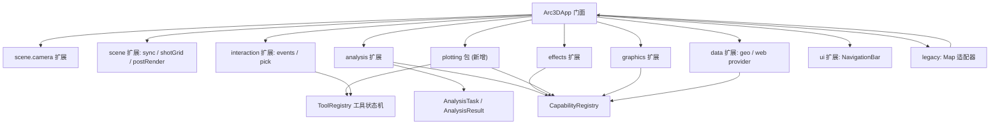

# LarkExplorer 能力迁移

Feature Name: larkexplorer-capability-migration
Updated: 2026-10-11

## Description

将旧版 `LarkExplorer-SDK`（v1.2.0 / CesiumJS 1.118.2）的全部业务能力迁移到当前 `Arc3DLab SDK`。迁移遵循当前设计标准：契约优先、能力注册、诊断与生命周期、统一分析任务、插件作用域与空间语义合同。

迁移以「能力等价、API 重塑」为原则：保留旧能力的行为语义，将其重塑为符合当前 SDK 边界的类型化接口，通过 `Arc3DApp` 的 Manager 与根入口具名导出对外提供；不重新导出 Cesium（消费者仍从 `cesium` 导入）。

范围外：旧 `ThirdPart` 的 Cesium 类再导出、旧 `global-api/lib-utils` 的全局库注册机制、旧 `jsdoc` 文档构建与 `gulp` 构建链。

## Architecture

旧能力按语义域重组到现有包边界，并新增一个 `@arc3dlab/plotting` 包承载军事态势标绘。



分层约束：

- `core` 提供纯计算与语义类型，不依赖引擎。
- `analysis` / `effects` / `graphics` / `plotting` 依赖 `core` 与引擎适配合同，通过 `Arc3DContext` 访问运行时。
- 交互工具统一注册到 `ToolRegistry`，遵循 `idle / deactivating / activating / active` 状态机。
- 计算类能力（缓冲、热力、洪水体积、路径分析）以 `runAnalysisTask` 运行并返回 `AnalysisResult`。

## Components and Interfaces

### core 扩展（`@arc3dlab/core`）

- `geo.ts`：纯几何与测地计算，不依赖引擎——`degreesToRadians`、`radiansToDegrees`、`normalizeHeading`、`angleBetweenHeadings`、`pointByHeadingDistance`、`greatCircleDistanceMeters`、`interpolateLngLat`、`interpolatePolyline`、`polygonCentroid`、`extentOf`，以及 `Extent` 与 `WGS84_SEMI_MAJOR_AXIS`。
- `screen.ts`（engine-cesium）：涉及场景的屏幕坐标与拾取换算 `cartesianFromPixel`、`pixelToLngLat`，以及地形取高 `sampleTerrainHeight`；这些能力需要相机 / 地形服务，归入引擎适配层而非 `core`。
- `datum.ts`：`GCJ02` / `BD09` / `WGS84` 互转：`wgs84ToGcj02`、`gcj02ToWgs84`、`gcj02ToBd09`、`bd09ToGcj02`、`wgs84ToBd09`、`bd09ToWgs84`、`outOfChina`。
- `active-style.ts`：`ActiveType`（`blink` / `scaling` / `jump`）与实体高亮应用 / 还原函数。
- `turf.ts`（薄封装）：`turfExtent`、`interpolateByDistance`。

### interaction 扩展（`@arc3dlab/interaction`）

- `event-handler.ts`：`ScreenEventController`，方法 `on(type, cb)` / `off` / `destroy`，事件类型覆盖左 / 右 / 中键、滚轮、移动、双击与捏合。
- `pick.ts` 扩展：`pickPosition(enabled, cb)`、`pickGlobal(enabled, cb)`、`pickWmts(enabled, options, cb)`、`pickPixel(viewer, position)`。
- `tooltip.ts` 扩展：`follow(html)` / `unfollow()` 鼠标跟随提示。

### scene 扩展（`@arc3dlab/scene`）

- `camera.ts` 扩展：`flyToExtent(extent, timeSec?, cb?)`、`zoomToItem(item)`、`flyToItem(item)`、`flyToLngLat(pos, timeSec?, cb?)`、`zoomToLngLat(pos, cb?)`、`aroundPoint(pos, angleDeg, periodSec, distanceM)`（返回 `AroundPointHandle`，含 `start` / `stop` / `destroy`）、`roam(points, times?, showPath?)`（返回 `RoamController`）。
- `viewport-metrics.ts`：纯计算 `metersPerPixelAtHeight`、`extentFromCenter` 与 `DEFAULT_VERTICAL_FOV`；`SceneController` 暴露 `scaleMetersPerPixel()` 与 `viewExtent()`。
- `post-render.ts`：`PostRenderController`（基于可移除监听接口，便于无引擎测试）；`SceneController` 暴露 `postRender` 与 `onPostRender(cb)`。
- `sync-viewer.ts`：`SyncViewer`，构造 `(primary, views)`，`destroy()`。
- `shot-grid.ts`：`captureGrid(options)`，按行列分幅导出 `Leaflet/图片` 集合。

### analysis 扩展（`@arc3dlab/analysis`）

- `buffer.ts`：`bufferPoint`、`bufferPolyline`、`bufferPolygon`（输入 WGS84 或笛卡尔，内部转 WGS84），全部返回首尾闭合的 WGS84 环。
- `measure-tools.ts`：交互式量测工具 `distance` / `area` / `height` / `azimuth` / `slope` / `triangle` / `volume`，每个工具返回 `MeasureToolHandle`（`deactivate` / `result`），任务化输出 `AnalysisResult`。
- `split.ts`：`SwipeComparison`（`enabled`、`direction`、`layer` 的 get/set，`destroy`），负责影像卷帘与分隔条。
- `path.ts`：`renderRoute(pathResult, options)` 返回 `RouteHandle`（`setVisible` / `destroy`），按 `PathSegment.status` 着色。
- `heatmap.ts`：`HeatmapOverlay`，`setData(list)`、`setType(2|3)`、`setOptions(options)`、`destroy`。
- `dynamic-heatmap.ts`：`DynamicHeatmapOverlay`，`init(data, options)`、`updateNoise(values)`、`destroy`。
- `flood.ts`：`FloodAnalysis`，`setRegion(positions, options)`、`setWaterLevel(height)`、`destroy`（水面后处理 + 区域裁剪）。

### effects 扩展（`@arc3dlab/effects`）

- `weather.ts`：`WeatherEffects`，`rain` / `snow` / `fog` / `lightning` 各含 `enable(options)` / `disable()` / `configure(options)`；基于全屏 `PostProcessStage`。
- `particles.ts`：`createFireParticle`、`createWaterGunParticle`、`createExplosionParticle`，返回带 `destroy` 的句柄。
- `materials.ts` 扩展：`DynamicSpreadMaterialProperty`、`PolylineTrailLinkMaterialProperty`，注册进 `MaterialRegistry`。
- flood 的水面着色器归属 `flood.ts`，与 `PostProcessManager` 协同。

### graphics 扩展（`@arc3dlab/graphics`）

- `dynamic/`：`addBillboard`、`addSpreadPoint`、`addRadarNormal`、`addRiver`、`addCircleDiffusion`、`addDynamicPolyline`、`addPanel`。
- `voxel.ts`：`MultiTileVoxel`，`showPoints(bool)`、`interpolate(x, y, z)`、`requestData(options)`、`destroy`。
- `flatten.ts`：`ModelFlatten`，`addPolygon(positions)`、`setEnabled(bool)`、`clear()`、`destroy`。

### plotting 包（`@arc3dlab/plotting`，新增）

- `symbols.ts`：`PlotSymbol` 枚举（24 类）与各符号参数类型。
- `plotting-manager.ts`：`PlottingManager`，`draw(symbol, options, cb)`、`results`、`remove(id)`、`removeAll()`；内部按符号分派到 `symbols/` 下的绘制器，复用 `ToolRegistry`。
- `algorithm.ts`：`PlotUtil` / `PlotCommon` 的纯几何算法（贝塞尔、箭头、弓形、集结地等），从旧 `third-party` 算法移植为 TypeScript。

### data 扩展（`@arc3dlab/data`）

- `web/provider.ts`：`WebServiceProvider` 接口：`driving(pos1, pos2)`、`poi(word, options)`、`geocode(address)`、`reverseGeocode(pos)`；`createGaodeProvider({ key, fetch? })` 作为内置参考实现。
- `web/types.ts`：`RouteResult` / `RouteStep` / `TmcSegment` / `PoiResult` / `GeocodeResult`。

### ui 扩展（`@arc3dlab/ui`）

- `navigation-bar.ts`：`NavigationBar`，`mount(container)`、`destroy()`；控件覆盖放大、缩小、复位、俯视、二维三维切换。

### legacy 扩展（`@arc3dlab/legacy`）

- `Map.ts`：`Map` 兼容类，构造 `(container, options?)`，暴露 `viewer` / `Layers` / `Terrain` / `Handler` / `Navigation` / `Weather` / `Components` / `SpecialAnalysis` / `MilitaryPlotting` / `Screen` / `Render`，内部委托到 `Arc3DApp`；`destroy()` 释放全部。

## Data Models

```ts
type Extent = [west: number, south: number, east: number, north: number]

interface CameraView { position: LngLatHeight; heading?: number; pitch?: number; roll?: number }

type MeasureKind = "distance" | "area" | "height" | "azimuth" | "slope" | "triangle" | "volume"
type DistanceType = "line" | "project" | "onground" | "elliptic"

interface BufferOptions { distance: number; steps?: number }

interface HeatmapDatum { lng: number; lat: number; value: number }
interface HeatmapOptions { radius?: number; gradient?: Record<string, string>; baseHeight?: number; primitiveType?: "TRIANGLES" | "LINES" }

type WeatherKind = "rain" | "snow" | "fog" | "lightning"
interface RainOptions { tiltAngle?: number; size?: number; speed?: number }

type PlotSymbol =
  | "point" | "billboard" | "polyline" | "curve" | "freeLine"
  | "polygon" | "freePolygon" | "regularPolygon" | "bow" | "ellipse"
  | "sector" | "circle" | "rectangle" | "roundRectangle" | "assemble"
  | "lineArrow" | "rightAngleArrow" | "straightArrow" | "attackArrow"
  | "swallowtailArrow" | "pincerArrow" | "flag" | "formation" | "label"

interface RouteSegment { polyline: LngLat[]; status: "unknown" | "smooth" | "slow" | "congested" | "severe" }
interface RouteResult { distance: number; duration: number; segments: RouteSegment[]; steps: RouteStep[] }

interface WebServiceProvider {
  driving(pos1: LngLat, pos2: LngLat): Promise<RouteResult>
  poi(word: string, options?: PoiOptions): Promise<PoiResult[]>
  geocode(address: string): Promise<GeocodeResult>
  reverseGeocode(pos: LngLat): Promise<GeocodeResult>
}

interface VoxelOptions { dimensions: [number, number, number]; bounds: Extent; valueField: string; colorScale?: string[] }
```

## Correctness Properties

1. **坐标往返**：`wgs84 → cartesian → wgs84` 与 `wgs84 ↔ gcj02 ↔ bd09` 的往返误差在 1e-6 度以内。
2. **缓冲闭合**：缓冲结果为闭合环，首个顶点与末个顶点一致。
3. **输入有效**：缓冲距离、量测点数量、热力图权重等非法输入返回 `Arc3DError`，不产生半成品图元。
4. **任务状态机**：`AnalysisTask` 的状态迁移限于合法路径，取消产出 `cancelled`，失败产出 `failed` 且携带错误码。
5. **工具一致性**：激活失败回滚到前一状态或 `idle`；注销活动工具先执行 `deactivate`。
6. **资源归零**：任意能力 `destroy()` 后，诊断快照中相关图元、监听、后处理阶段与待处理任务计数归零。
7. **幂等特效**：重复 `enable` / `disable` 特效不产生重复阶段，也不残留已移除阶段。
8. **无密钥泄漏**：`WebServiceProvider` 的凭据由消费者注入，仓库与产物中不包含密钥。

## Error Handling

统一使用 `Arc3DError(code, message, cause?)`，新增错误码：

- `UNSUPPORTED_CAPABILITY`：引擎后端不提供所需能力。
- `INVALID_ARGUMENT`：参数越界或类型非法（如非正缓冲距离）。
- `PROVIDER_UNAVAILABLE`：未注入 Web 服务提供者。
- `MISSING_CREDENTIALS`：提供者缺少凭据。
- `RESOURCE_DISPOSED`：在已销毁对象上继续操作。

交互工具异常时执行 `try / finally`，保证撤销与清理完成。粒子与后处理特效在 `destroy()` 中移除监听与阶段。

## Test Strategy

- **单元测试（vitest）**：坐标与几何往返、缓冲闭合与非法输入、量测计算、材质 `equals` 与 `definitionChanged`、标绘算法纯几何、高亮语义应用与还原。
- **契约测试（Fake Engine）**：能力注册与 `hasCapability` 回报、诊断归零、工具状态机、任务状态迁移与取消，全部不导入 Cesium。
- **组件测试**：`Map` 兼容适配器把方法映射到 `Arc3DApp`，销毁后无残留。
- **浏览器 E2E（Playwright + SwiftShader）**：扩展 `e2e/app.spec.ts`，覆盖创建 → 标绘/量测 → 天气特效开关 → 卷帘 → 销毁 → 重建。
- **文档与门禁**：新公共符号补齐中文 TSDoc；`lint:docs` 覆盖率达标；`gate` 与 CI 全绿；开发指南站与 API 文档站补充对应章节。

## Phases

| 阶段 | 内容 | 主要产出 |
|---|---|---|
| P0 基础 | core geo / datum、interaction 事件与拾取、scene 指标与 postRender、legacy `Map` 适配器、能力与诊断接线 | `geo.ts` `datum.ts` `event-handler.ts` `Map.ts` |
| P1 分析 | 交互式量测、缓冲、卷帘、路径、热力图、动态热力图、洪水 | `analysis/*` 新模块与任务化方法 |
| P2 特效 | 天气四类、粒子三类、动态扩散与线尾迹材质 | `effects/*` 新模块与材质注册 |
| P3 标绘 | `@arc3dlab/plotting` 包与 24 类符号、几何算法移植 | 新包与单测 |
| P4 动态与可视化 | 动态图形、体素、模型压平、多屏联动、场景出图 | `graphics/*` `scene/*` 新模块 |
| P5 组件与数据 | NavigationBar、Web provider、高亮语义 | `ui/*` `data/web/*` `core/active-style.ts` |
| P6 文档与门禁 | 指南与 API 文档章节、E2E 扩展、覆盖率与体积基线刷新 | 文档与 CI |

## References

[^1]: (Repository) - [LarkExplorer-SDK-API](https://github.com/jianlei-wang/LarkExplorer-SDK-API)
[^2]: (File) - [旧版 Map 主类](../../../../tmp/lark-sdk/src/modules/Map.js)
[^3]: (File) - [旧版 Creator / Add](../../../../tmp/lark-sdk/src/modules/core/Creator.js)
[^4]: (File) - [旧版 Buffer 分析](../../../../tmp/lark-sdk/src/modules/core/analysis/Buffer.js)
[^5]: (File) - [旧版 MilitaryPlotting](../../../../tmp/lark-sdk/src/modules/utils/plotting/index.js)
[^6]: (File) - [旧版 Rain 天气](../../../../tmp/lark-sdk/src/modules/utils/weather/Rain.js)
[^7]: (File) - [当前分析包](../../../../packages/analysis/src/index.ts)
[^8]: (File) - [当前能力注册](../../../../packages/core/src/capabilities.ts)
[^9]: (File) - [迁移指引](../../../../docs/architecture/13-migration.md)
