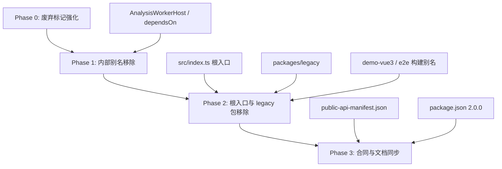

# 旧版兼容内容收敛（Legacy Content Sunset）

Feature Name: legacy-content-sunset
Updated: 2026-10-12

## Description

本特性定义在 `2.0.0` 版本线中逐步移除 SDK 内旧版兼容资产的设计与执行路径。旧版兼容资产是 `LarkExplorer-SDK` 迁移期间引入的过渡层，现已冻结；本特性将其从源码、构建别名、发布合同与文档中收敛，使公共 API 只保留当前契约符号。

设计原则：

- **契约优先**：移除后公共表面只保留 `@arc3dlab/*` 当前导出，`public-api-manifest.json` 作为唯一基线。
- **分阶段可验证**：每个阶段是独立提交，阶段边界即回退点，须通过 `gate:fast` 与 `test:e2e`。
- **文档先行**：破坏性变更同步更新 `COMPATIBILITY.md`、`docs/architecture/13-migration.md`、`CHANGES.md`。
- **版本对齐**：全部移除随 `2.0.0` 发布，符合 `COMPATIBILITY.md` 的 Major 承诺。

## Architecture

收敛过程围绕发布入口、内部包与构建别名三条链展开，阶段与依赖关系如下：

阶段划分：

| 阶段 | 内容 | 破坏性 | 版本动作 |
|---|---|---|---|
| Phase 0 | 强化 `@deprecated` JSDoc、补迁移文档与窗口说明 | 否 | 保持 1.x |
| Phase 1 | 移除 `AnalysisWorkerHost` 别名、`Arc3DPlugin.dependsOn` 字段 | 是 | 进入 2.0.0 线 |
| Phase 2 | 移除根入口 `Viewer`/`Map` 导出、`@arc3dlab/legacy` 包与构建别名 | 是 | 2.0.0 |
| Phase 3 | 刷新 API 基线、提升版本、更新 `CHANGES.md`/`COMPATIBILITY.md` | 否 | 2.0.0 发布 |

## Components and Interfaces

### 根入口（`src/index.ts`）

- 当前位置：`src/index.ts:101-102` 再导出 `Viewer`、`Map` 及 `LegacyViewerOptions`、`LegacyMapOptions`。
- 移除动作：删除这两行 re-export；其余 `@arc3dlab/sdk` 命名导出保持不变。
- 影响面：`demo-vue3`、`examples`、`guide` 已确认不引用旧版符号（仅 `guide/migration/viewer.md` 文档提及）。

### 兼容适配器包（`packages/legacy`）

- 组成：`src/Viewer.ts`（`Viewer`，`packages/legacy/src/Viewer.ts:27`）、`src/Map.ts`（`Map`，`packages/legacy/src/Map.ts:32`）、`src/index.ts` 汇总导出。
- 移除动作：删除整个 `packages/legacy` 目录，清理 `package.json` workspaces 中对应项与 `package-lock.json`。
- 迁移替代：`Viewer` → `Arc3D.create()` / `Arc3D.createSync()`；`Map` 的图层、地形、交互、导航、标绘入口 → `Arc3DApp` 对应 Manager。

### 插件契约（`packages/sdk/src/plugins.ts`）

- 位置：`Arc3DPlugin.dependsOn`（`packages/sdk/src/plugins.ts:15-16`）与回退解析（`:129` `plugin.requiresCapabilities ?? plugin.dependsOn ?? []`）。
- 移除动作：删除 `dependsOn` 字段声明与回退分支，能力依赖统一经 `requiresCapabilities` 声明，插件依赖经 `dependsOnPlugins` 声明。
- 引用更新：`examples/domain-plugins/mining-plugin.ts:71` 由 `dependsOn` 改为 `requiresCapabilities`。
- 注意：`packages/core/src/commands.ts:42` 与 `tools.ts:16` 的 `dependsOn` 表达命令/工具执行顺序依赖，语义合法，保留。

### 分析任务宿主（`packages/analysis/src/index.ts`）

- 位置：`AnalysisJobHost as AnalysisWorkerHost` 兼容别名（`packages/analysis/src/index.ts:621`）。
- 移除动作：删除别名行，仅导出 `AnalysisJobHost`。
- 引用更新：`tests/unit/analysis-worker.test.ts` 改用 `AnalysisJobHost`；测试文件可同步改名为 `analysis-job-host.test.ts`。

### 构建别名（`demo-vue3/vite.config.ts`、`e2e/vite.config.ts`）

- 位置：`demo-vue3/vite.config.ts:24`、`e2e/vite.config.ts:31` 的 `@arc3dlab/legacy` 别名。
- 移除动作：随 `@arc3dlab/legacy` 包移除同步删除对应 alias 配置。

### 文档与合同

- `COMPATIBILITY.md`：补充「1.x → 2.0 迁移窗口与截止版本」及旧版符号目标移除版本。
- `docs/architecture/13-migration.md`：更新「废弃计划」表为实际执行结果，保留旧成员映射作为历史迁移参考。
- `guide/migration/viewer.md`：标注旧版入口移除状态，迁移示例保留。
- `CHANGES.md`：在 Unreleased/Breaking 区记录移除项与迁移指引链接。
- `scripts/public-api-manifest.json`：经 `node scripts/release-gate.mjs exports:update` 重新生成。

## Data Models

无新增数据结构。受影响的静态数据为：

- `scripts/public-api-manifest.json`：`values` / `types` / `signatures` 三组以 `"."` / `"./engine-cesium"` 为键的导出集合，移除后条目减少。
- `package.json`：`version` 提升为 `2.0.0`；`workspaces` 移除 `packages/legacy`。
- `package-lock.json`：同步移除 `@arc3dlab/legacy` 工作区条目。

## Correctness Properties

1. 移除完成后，根入口与 `@arc3dlab/sdk` 的导出集合等于 `public-api-manifest.json` 记录值。
2. 移除后任一旧版符号（`Viewer`、`Map`、`LegacyViewerOptions`、`LegacyMapOptions`、`AnalysisWorkerHost`、`Arc3DPlugin.dependsOn`）不再出现在类型声明与运行时可导出符号中。
3. 阶段执行期间，未到达的后续阶段资产保持可用，阶段边界提交各自独立通过门禁。
4. `packages/core` 中 `commands.ts`/`tools.ts` 的 `dependsOn` 语义在移除后保持不变。
5. `guide` 站点构建与 `demo-vue3`、`e2e` 运行在移除构建别名后仍正常。

## Error Handling

- 若消费者在 2.0.0 后仍导入旧版符号，TypeScript 编译与打包器解析将报未导出错误；迁移文档负责提供替代入口，不提供惰性运行时兜底。
- 若移除 `packages/legacy` 后遗漏构建别名，`demo-vue3`/`e2e` 启动会出现模块解析失败；通过 `test:e2e` 与 `demo-vue3` 构建验证覆盖。
- 若 API 基线与出口不一致，`gate:release` 的 `lint:exports`/`lint:api` 校验将失败并阻断推送。

## Test Strategy

- 单元测试：`tests/unit/analysis-job-host.test.ts` 验证 `AnalysisJobHost` 直接导出的行为；插件依赖测试改为仅经 `requiresCapabilities`。
- 静态校验：`npx tsc --noEmit` 确认无对已移除符号的引用。
- 发布门禁：`npm run gate:fast`、`npm run gate:release`（含导出与 API 基线校验）。
- 端到端：`npm run test:e2e` 验证构建别名移除后运行正常；`PERF=1` 场景回归资源回收。
- 基线刷新：`node scripts/release-gate.mjs exports:update` 生成新基线并纳入同一阶段提交。

## References

[^1]: (`packages/legacy/src/Viewer.ts#L27`) - [Legacy Viewer 适配器定义](packages/legacy/src/Viewer.ts)
[^2]: (`packages/legacy/src/Map.ts#L32`) - [Legacy Map 适配器定义](packages/legacy/src/Map.ts)
[^3]: (`src/index.ts#L101`) - [根入口旧版再导出](src/index.ts)
[^4]: (`packages/sdk/src/plugins.ts#L15`) - [废弃 dependsOn 字段](packages/sdk/src/plugins.ts)
[^5]: (`packages/analysis/src/index.ts#L621`) - [AnalysisWorkerHost 兼容别名](packages/analysis/src/index.ts)
[^6]: (`docs/architecture/13-migration.md`) - [旧目录迁移映射与废弃计划](docs/architecture/13-migration.md)
[^7]: (`COMPATIBILITY.md`) - [兼容性与版本策略](COMPATIBILITY.md)
