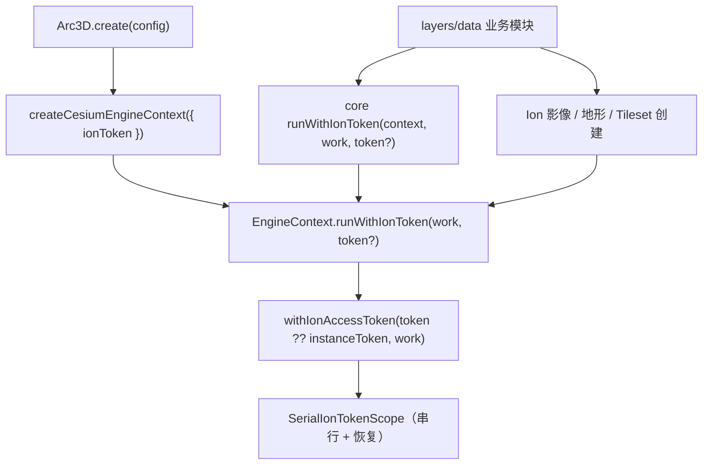

# Cesium Ion 令牌实例级合同

Feature Name: ion-token-contract
Updated: 2026-10-15

## Description

将 Ion 令牌的取得、应用、异步执行与恢复统一到实例级合同，消除 Ion 影像绕过令牌作用域的缺陷：

- `EngineContext`（core）新增可选方法 `runWithIonToken(work, token?)`，由 engine-cesium 绑定实例令牌与共享串行作用域。
- core 提供容错封装 `runWithIonToken(context, work, token?)`，无引擎能力时直接执行工作。
- `createImageryProvider` / `createProviderHandle` 改为接收选项对象 `{ tdtToken?, runWithIonToken? }`，Ion 分支在 `runWithIonToken` 内执行。
- 地形与 Tileset 改用同一入口，业务模块不再直接组合 `readIonToken` 与 `withIonAccessToken`。

合同与决策见 `.monkeycode/specs/2026-10-15-ion-token-contract/requirements.md`。

## Architecture



实例令牌来自 `EngineViewerOptions.ionToken`（`Arc3D.buildApp` 由 `engine.cesium.ionToken` 或 `tokens.cesiumIon` 解析）。所有 Ion 操作经同一入口，落到既有的 `SerialIonTokenScope`，因此跨实例并发仍按串行顺序设置与恢复全局令牌。

## Components and Interfaces

### core：`RunWithIonToken` 与 `EngineContext`

```ts
export type RunWithIonToken = <T>(
  work: () => Promise<T>,
  token?: string,
) => Promise<T>

export interface EngineContext {
  readonly type: string
  readonly viewer: EngineViewer
  readonly native: { viewer: unknown }
  readonly engine?: Engine
  /** 在实例 Ion 令牌作用域内执行异步工作（引擎实现提供）。 */
  runWithIonToken?: RunWithIonToken
}
```

### core：容错封装 `runWithIonToken`

```ts
export function runWithIonToken<T>(
  context: Arc3DContext,
  work: () => Promise<T>,
  token?: string,
): Promise<T>
```

存在 `context.engine.runWithIonToken` 时委托之；否则直接执行 `work()`（无引擎的单元测试上下文）。

### engine-cesium：绑定实例令牌

`createCesiumEngineContext(options)` 返回的 `EngineContext` 增加：

```ts
runWithIonToken: (work, token) =>
  withIonAccessToken(token ?? options.ionToken, work)
```

### data：`ProviderOptions`

```ts
export interface ProviderOptions {
  /** 天地图备用令牌。 */
  tdtToken?: string
  /** 实例级 Ion 令牌执行入口。 */
  runWithIonToken?: RunWithIonToken
}

export function createImageryProvider(
  spec: ProviderSpec,
  options?: ProviderOptions,
): Promise<ImageryProvider>

export function createProviderHandle(
  spec: ProviderSpec,
  options?: ProviderOptions,
): Promise<ProviderHandle>
```

Ion 分支：

```ts
if (spec.type === "ion") {
  if (spec.assetId === undefined) {
    throw new Arc3DError("INVALID_ARGUMENT", "Ion imagery requires assetId")
  }
  const create = () => IonImageryProvider.fromAssetId(spec.assetId as number)
  return options.runWithIonToken
    ? options.runWithIonToken(create, spec.token)
    : create()
}
```

`spec.token` 作为 Ion 覆盖令牌；天地图优先使用 `spec.token`，否则 `options.tdtToken`。

### layers：调用点收敛

- `ImageryOverlayManager.add` / `BasemapManager.set`：传 `{ tdtToken, runWithIonToken: (work, token) => runWithIonToken(context, work, token) }`。
- `TerrainManager.set`（ion）：`readIonToken(config)` 取令牌用于 `AUTH_FAILED` 校验，再经 `runWithIonToken(context, work, token)` 执行。
- `TilesetManager.add`（assetId）：直接经 `runWithIonToken(context, work)` 执行。

## Data Models

### 令牌来源与优先级

| 场景 | 令牌来源 | 覆盖 |
| --- | --- | --- |
| 实例默认 | `EngineViewerOptions.ionToken` | — |
| Ion 影像 | 实例令牌 | `ProviderSpec.token` |
| Ion 地形 | 实例令牌（来自 `readIonToken(config)`） | — |
| Ion Tileset | 实例令牌 | — |

### 执行与恢复

`SerialIonTokenScope.run(token, work)`：所有调用进入同一串行 `chain`；`token` 非空时保存 `Cesium.Ion.defaultAccessToken`、写入、执行、在 `finally` 恢复；`token` 为空时排队后直接执行。该语义保持不变。

## Correctness Properties

1. **统一路径**：Ion 影像、地形、Tileset 的创建都在实例级 `runWithIonToken` 内执行。
2. **令牌生效**：配置了实例令牌时，Ion 影像观察到的全局令牌等于该令牌。
3. **恢复**：任一 Ion 操作结束后全局令牌恢复为操作前的值（含异常路径）。
4. **覆盖优先**：`ProviderSpec.token` 存在时优先于实例令牌。
5. **无令牌不阻断**：Ion 影像在无令牌时仍创建（不抛 `AUTH_FAILED`）。
6. **地形语义保持**：Ion 地形无令牌时仍抛 `AUTH_FAILED`。
7. **降级**：无 `runWithIonToken` 能力时直接执行 `work()`。

## Error Handling

- Ion 影像缺 `assetId`：`Arc3DError("INVALID_ARGUMENT")`。
- Ion 地形缺 `assetId`：`Arc3DError("INVALID_ARGUMENT")`；缺令牌：`Arc3DError("AUTH_FAILED")`。
- 令牌临界区抛错：`finally` 中恢复全局令牌后再向上抛出。
- 无引擎上下文：core 封装回退为直接执行。

## Test Strategy

- 新增 `tests/unit/ion-imagery-token.test.ts`：注入假 `runWithIonToken`，断言 Ion 影像创建在 runner 内执行并携带 `spec.token` 覆盖；断言实例令牌生效与结束后恢复；断言缺 `assetId` 报错；断言无 runner 时直接创建。
- 扩展 `tests/unit/ion-token.test.ts` 或新增用例：core 封装在有无 `runWithIonToken` 时的行为。
- 更新 `tests/unit/layers-terrain.test.ts`：断言 Ion 地形经实例入口且保持 `AUTH_FAILED`。
- 更新 `tests/unit/layers-basemap.test.ts` 与新增 imagery 用例：断言调用方传入 `runWithIonToken` 选项。
- 复用 `ion-token.test.ts` 覆盖多实例不同令牌互不串扰。

## References

[^1]: (File#L156) - Ion 影像未走令牌作用域（packages/data/src/providers.ts）
[^2]: (File#L61) - 地形经 readIonToken + withIonAccessToken（packages/layers/src/terrain.ts）
[^3]: (File#L43) - Tileset 经 withIonAccessToken（packages/layers/src/tileset.ts）
[^4]: (File#L34) - EngineViewerOptions.ionToken 未被应用（packages/sdk/src/Arc3D.ts）
[^5]: (File) - 令牌作用域实现（packages/engine-cesium/src/ion.ts）
