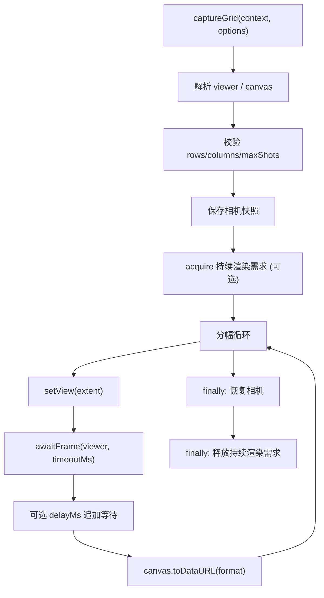
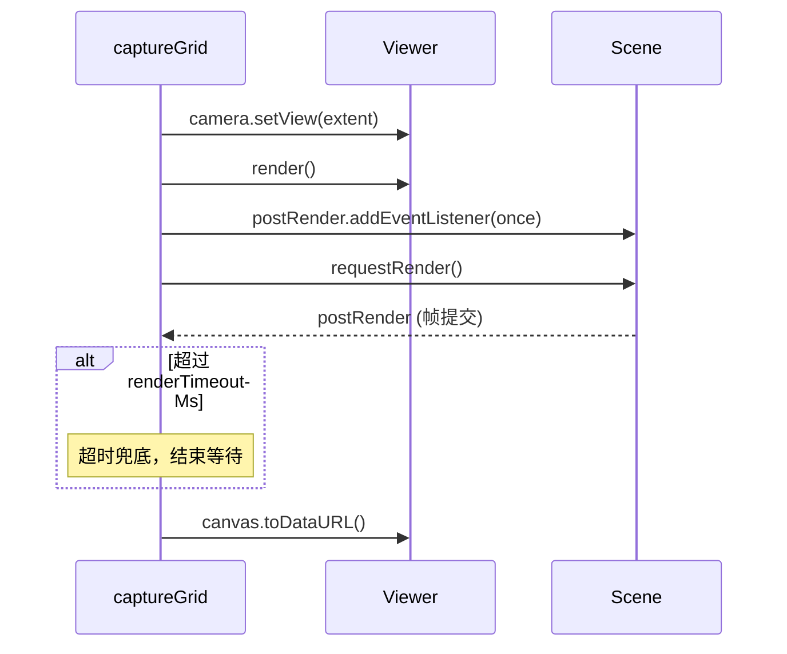

# 网格出图的渲染同步与状态恢复

Feature Name: shot-grid-capture
Updated: 2026-10-15

## Description

修复 `captureGrid()`（`packages/scene/src/shot-grid.ts`）的两个缺陷并加固参数约束：

- 每个 Cell 在设置相机后请求并等待一帧渲染，再采集画布，保证导出图片对应当前范围，而非上一视图。
- 在 `try/finally` 中保存与恢复相机状态（及被临时影响的渲染设置），正常与异常路径都不改变用户视图。
- 校验 `rows` / `columns` 为 `≥ 1` 的整数，并以 `maxShots`（默认 `64`）约束分幅总数。

合同与决策见 `.monkeycode/specs/2026-10-15-shot-grid-capture/requirements.md`。

## Architecture



校验在任何相机变更之前完成。相机快照与恢复封装为独立函数，持续渲染需求通过既有 `EngineViewer.acquireContinuousRender` 机制申请，避免直接改写 `scene.requestRenderMode`。

## Components and Interfaces

### `ShotGridOptions`（扩展）

```ts
interface ShotGridOptions {
  rows: number
  columns: number
  extent: Extent
  format?: string // 默认 image/png
  delayMs?: number // 每幅额外等待，默认 0
  maxShots?: number // 分幅上限，默认 64
  renderTimeoutMs?: number // 渲染完成兜底超时，默认 1000
}
```

### 内部函数

- `assertGridArgs(rows, columns, maxShots)`：校验整数与非零正数、以及 `rows × columns ≤ maxShots`，失败抛 `Arc3DError("INVALID_ARGUMENT")`。
- `captureCameraState(camera): CameraSnapshot | undefined`：当 `camera.positionWC` 与 `camera.setView` 可用时，克隆位置并读取 heading/pitch/roll（弧度）；否则返回 `undefined`（无状态可恢复）。
- `restoreCameraState(camera, snapshot)`：通过 `camera.setView` 恢复位置与朝向。
- `awaitFrame(viewer, timeoutMs)`：`viewer.render()` 同步渲染一帧；若 `scene.postRender.addEventListener` 可用，注册一次性监听并 `scene.requestRender()`，在下一帧信号或超时后解决。

## Data Models

### `CameraSnapshot`

```ts
interface CameraSnapshot {
  position: Cartesian3 // positionWC 的克隆
  heading: number // 弧度
  pitch: number // 弧度
  roll: number // 弧度
}
```

`heading` / `pitch` / `roll` 与 `Camera.setView` 的 orientation 同为弧度，恢复时无需单位换算。

### 渲染等待时序



## Correctness Properties

1. **帧一致**：每个 Cell 在采集前至少触发一次渲染请求并等待一帧信号。
2. **视图不变**：出图结束时相机恢复到出图前的位置与朝向（正常与异常路径）。
3. **无泄漏**：持续渲染需求在 `finally` 中释放，异常路径不残留。
4. **参数先行**：非法参数在相机变更前抛错。
5. **顺序稳定**：结果按行优先顺序返回，含 `row`、`column`、`extent`、`image`。
6. **能力降级**：缺少 `render` / `postRender` 能力时立即采集，保持既有行为。

## Error Handling

- `rows` / `columns` 非整数或 `< 1`：抛 `Arc3DError("INVALID_ARGUMENT")`。
- `rows × columns > maxShots`：抛 `Arc3DError("INVALID_ARGUMENT")`。
- 无 `canvas` 或 `toDataURL`：抛 `Arc3DError("UNSUPPORTED_CAPABILITY")`。
- 采集或等待期间抛错：`finally` 仍恢复相机并释放持续渲染需求，随后向上抛出原错误。
- viewer 在出图期间销毁：恢复前检查 `destroyed` 与相机可用性，跳过失效写入。

## Test Strategy

扩展 `tests/unit/scene-sync-shotgrid.test.ts`：

- **渲染请求**：断言每个 Cell 触发一次 `render` / `requestRender` 与一次 `toDataURL`。
- **相机恢复**：使用支持 `positionWC` 与 `setView` 的假相机，断言正常与异常路径都恢复原始位置与朝向。
- **参数校验**：`rows: 0`、`columns: -1`、非整数、`rows × columns > maxShots` 抛 `INVALID_ARGUMENT`，且未调用 `setView`。
- **批量上限**：`maxShots` 可覆盖默认值。
- **超时兜底**：`postRender` 存在但不触发的假场景，`renderTimeoutMs` 后仍完成采集。
- **降级**：无 `render` / `postRender` 的假 viewer 仍能采集。
- 保留 `subdivideExtent`、无画布错误、facade 调用等既有断言。

## References

[^1]: (File#L91) - 逐块 setView / delay / toDataURL 循环（packages/scene/src/shot-grid.ts）
[^2]: (File#L85) - 行列数仅下限钳制（packages/scene/src/shot-grid.ts）
[^3]: (File#L151) - 既有 `captureImage()` 先 `viewer.render()` 再导出（packages/scene/src/scene-controller.ts）
[^4]: (File) - 既有出图测试（tests/unit/scene-sync-shotgrid.test.ts）
