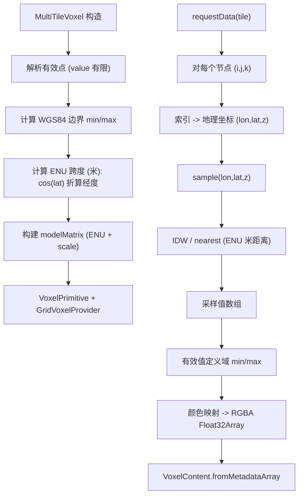

# 体素数据合同与空间插值

Feature Name: voxel-data-contract
Updated: 2026-10-15

## Description

修复 `MultiTileVoxel`（`packages/graphics/src/voxel.ts`）的核心输出缺陷，使体素网格采样值真实表达输入点数据的空间分布：

- 网格节点采样由索引派生值改为基于 `pointData` 的空间插值（默认 IDW，可选最近邻）。
- 距离度量统一到以盒中心为原点的 ENU 局部坐标系，经度按 `cos(centerLat)` 折算为米，不再混算“度”与“米”。
- 体素盒垂直跨度改用高程跨度 `maxZ - minZ`，并修正节点索引到地理坐标的映射。
- 明确缺失值规则（`value = NaN`）与颜色定义域（来自有效采样值）。

合同与决策见 `.monkeycode/specs/2026-10-15-voxel-data-contract/requirements.md`。

## Architecture



节点几何、采样与颜色映射在 `requestData` 单次遍历中完成两阶段：先算采样值与定义域，再生成颜色。`interpolate()` 复用同一采样函数，保证公共 API 与网格内部一致。

## Components and Interfaces

### `VoxelPoint`（不变）

```ts
interface VoxelPoint {
  x: number // WGS84 经度（度）
  y: number // WGS84 纬度（度）
  z: number // 相对 WGS84 椭球面的高程（米）
  value: number // 标量；NaN 表示缺失
}
```

### `VoxelOptions`（扩展）

```ts
interface VoxelOptions {
  dimensions?: number // 每维节点数，默认 15
  colorsList?: string[] // 颜色刻度，默认 DEFAULT_COLORS
  method?: "idw" | "nearest" // 插值方法，默认 "idw"
  power?: number // IDW 幂次，默认 2
  padding?: number // 各维度按米扩展范围，默认 0
}
```

### `MultiTileVoxel`（行为变更）

- `interpolate(x, y, z): number`：使用配置的 `method`/`power` 在 ENU 米距离下插值；无有效点返回 `NaN`。
- `requestData(options)`：仅支持 `tileLevel === 0`；返回 `[Float32Array]`，每个节点 4 通道 RGBA。
- `showPoints`、`destroy`：行为保持；点颜色使用输入点的数值定义域。

## Data Models

### 坐标系与单位折算

以盒中心为原点的 ENU 局部坐标系，单位米：

- 纬度每度米数：`METERS_PER_DEGREE_LATITUDE = 110540`
- 经度每度米数：`METERS_PER_DEGREE_LONGITUDE = 111320 × cos(centerLatRad)`
- 高程：直接用米

### 网格几何

设有效点边界 `minX/maxX/minY/maxY/minZ/maxZ`，中心 `center = ((minX+maxX)/2, (minY+maxY)/2, (minZ+maxZ)/2)`，`padding = p`（米）：

- `spanZM = max((maxZ - minZ) + 2p, MIN_AXIS_SPAN)`
- `spanXM = max((maxX - minX) × metersPerDegLon + 2p, MIN_AXIS_SPAN)`
- `spanYM = max((maxY - minY) × metersPerDegLat + 2p, MIN_AXIS_SPAN)`
- `MIN_AXIS_SPAN = 1`（米），保证零跨度维度非退化

节点索引 `(i, j, k)`，`t = N === 1 ? 0 : index / (N - 1)`：

- ENU 偏移：`east = (tX - 0.5) × spanXM`，`north = (tY - 0.5) × spanYM`，`up = (tZ - 0.5) × spanZM`
- 采样地理坐标：`lon = centerLon + east / metersPerDegLon`，`lat = centerLat + north / metersPerDegLat`，`z = centerZ + up`
- 模型矩阵：`eastNorthUpToFixedFrame(fromDegrees(center))`，缩放半轴 `(spanXM/2, spanYM/2, spanZM/2)`

端点节点（`t = 0` 与 `t = 1`）落在盒边界上，覆盖完整范围。

### 距离与插值

对查询点 `q` 与输入点 `p`：

- `dx = (q.lon - p.x) × metersPerDegLon`
- `dy = (q.lat - p.y) × metersPerDegLat`
- `dz = q.z - p.z`
- `d = sqrt(dx² + dy² + dz²)`

- `nearest`：取最小 `d` 对应点值。
- `idw`：`w = 1 / dᵖ`，`value = Σ(wᵢ vᵢ) / Σ(wᵢ)`；若存在 `d < ε`，直接返回该点值。
- 无有效点：返回 `NaN`。

### 颜色映射

- 定义域 `[domainMin, domainMax]` 取自有效（有限）采样值。
- `norm = domainMax === domainMin ? 0 : (clamp(v) - domainMin) / (domainMax - domainMin)`
- `ratio = 1 - norm`；`index = clamp(floor(ratio × colorsList.length), 0, len - 1)`
- 方向：高值映射到 `colorsList[0]`，低值映射到 `colorsList[len - 1]`。
- 缺失节点输出 `(0, 0, 0, 0)`（透明）。

## Correctness Properties

1. **数据依赖**：`requestData()` 输出随 `pointData` 数值变化；不同数值集产生不同采样数组。
2. **常量保持**：全部有效点同值时，所有有效节点采样值等于该常数。
3. **精确命中**：查询坐标与某有效点一致时，`interpolate` 返回该点值。
4. **几何对应**：垂直跨度等于高程跨度（叠加 padding 与最小跨度约束）。
5. **缺失排除**：`NaN` 值点不参与边界、定义域与插值；全缺失时输出透明。
6. **节点覆盖**：端点节点落在盒边界，索引映射为线性。
7. **一致性**：`interpolate()` 与网格采样使用同一方法与度量。

## Error Handling

- 空点集或全部缺失：`buildPrimitive` 不创建图元；`requestData` 返回全透明数组；`interpolate` 返回 `NaN`。
- `dimensions < 2`：按 `N === 1` 分支处理，`t = 0`，避免除零。
- `power <= 0`：回退默认 `2`。
- `colorsList` 为空：回退 `DEFAULT_COLORS`。
- 无 `viewer`（纯 Node 测试环境）：`buildPrimitive` 与 `showPoints` 直接返回。

## Test Strategy

新增 `tests/unit/graphics-voxel-interpolation.test.ts`，使用合成数据：

- **数据依赖**：同几何、不同 `value` 两组点，采样数组不相等。
- **常量保持**：所有点 `value = 7`，断言全部有效节点采样值为 `7`。
- **已知答案**：构造沿一个轴的线性数据，断言节点采样值随位置单调变化且落在期望区间；一维对称点断言中点为两端均值（IDW 对称性）。
- **精确命中**：`interpolate` 命中输入点值。
- **nearest 方法**：`method: "nearest"` 下节点取最近点值。
- **几何**：断言 `maxZ - minZ` 生效（通过构造仅高程不同的点，验证 primitive 缩放或暴露的跨度）。
- **缺失值**：含 `NaN` 点被排除；全 `NaN` 输出透明。
- **边界**：`dimensions: 1`、空点集、`tileLevel > 0` 返回 `undefined`。

保留并更新现有 `tests/unit/graphics-voxel-flatten.test.ts` 的体素用例，使其断言采样值受输入数据影响。

## References

[^1]: (File#L234) - `sampleGrid` 索引派生值缺陷（packages/graphics/src/voxel.ts）
[^2]: (File#L215) - 垂直跨度误用数值范围（packages/graphics/src/voxel.ts）
[^3]: (File#L125) - 度/米混算的欧氏距离（packages/graphics/src/voxel.ts）
[^4]: (File) - 现有体素测试（tests/unit/graphics-voxel-flatten.test.ts）
