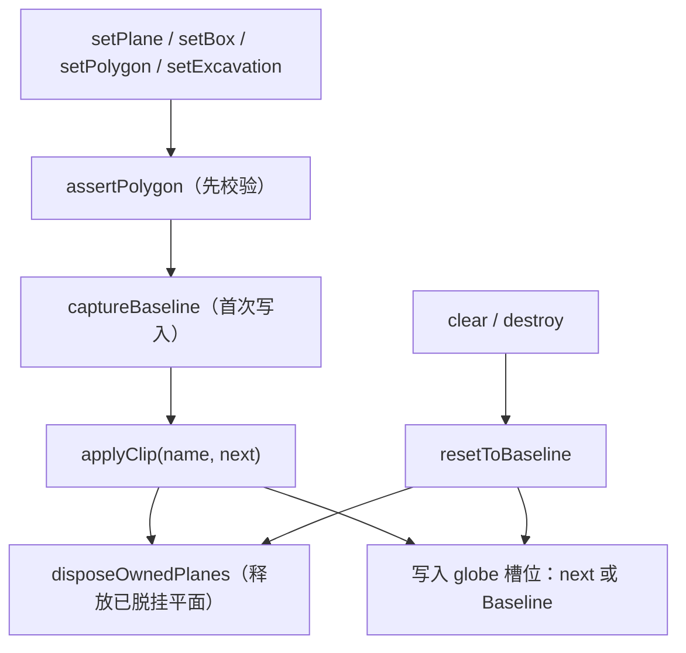

# ClipAnalysis 裁剪对象所有权与状态一致性

Feature Name: clip-ownership
Updated: 2026-10-16

## Description

为 `@arc3dlab/analysis` 的 `ClipAnalysis`（`packages/analysis/src/clip.ts`）建立明确的所有权与状态模型：

- 首次写入 `Globe` 裁剪槽位前捕获 Baseline，`clear()` / `destroy()` 时释放自有集合并恢复 Baseline。
- 仅在可证明为自有集合时才释放，绝不释放外部集合。
- 输入无效（顶点少于 3 个）时在变更场景之前抛 `INVALID_ARGUMENT`，旧裁剪与 `list()` 保持有效。
- 统一各设置方法（`setPlane` / `setBox` / `setPolygon` / `setExcavation`）的挂载与释放路径。

需求见 `.monkeycode/specs/2026-10-16-clip-ownership/requirements.md`。

## Architecture



所有挂载与释放都经由 `applyClip()` 与 `resetToBaseline()`，避免分散的槽位改写。

## Components and Interfaces

### 新增/调整的私有状态（`ClipAnalysis`）

```ts
private active: string[] = []
private excavation: ExcavationResult | undefined
private captured = false
private baselinePlanes: ClippingPlaneCollection | undefined
private baselinePolygons: ClippingPolygonCollection | undefined
private ownedPlanes: ClippingPlaneCollection | undefined
```

公共方法签名保持不变：`setPlane` / `setBox` / `setPolygon` / `setExcavation` / `list` / `clear` / `destroy`。

### 核心私有方法

```ts
private globe(): ClippingHost                          // 读取当前 Globe 裁剪槽位
private captureBaseline(globe): void                    // 首次写入前记录 Baseline
private disposeOwnedPlanes(collection): void            // 释放已脱挂的自有平面集合
private restorePlanes(): ClippingPlaneCollection | undefined   // 计算平面槽位恢复值
private applyClip(name, next): void                     // 统一挂载
private resetToBaseline(): void                         // 释放自有并恢复 Baseline
```

自有多边形集合无需显式释放：Cesium 1.145+ 的多边形集合不再持有 GPU 资源，槽位替换即解除引用，交由 GC 回收。

### `applyClip` 语义

```ts
private applyClip(
  name: string,
  next: {
    planes?: ClippingPlaneCollection
    polygons?: ClippingPolygonCollection
  },
): void {
  const globe = this.globe()
  this.captureBaseline(globe)
  const previousPlanes = this.ownedPlanes
  this.ownedPlanes = undefined
  globe.clippingPlanes = next.planes ?? this.restorePlanes()
  this.ownedPlanes = next.planes
  globe.clippingPolygons = next.polygons ?? this.baselinePolygons
  this.disposeOwnedPlanes(previousPlanes)
  this.active = [name]
}
```

### `resetToBaseline` 语义

```ts
private resetToBaseline(): void {
  if (this.captured) {
    const globe = this.globe()
    const previousPlanes = this.ownedPlanes
    this.ownedPlanes = undefined
    globe.clippingPlanes = this.restorePlanes()
    restorePolygons(globe, this.baselinePolygons)
    this.disposeOwnedPlanes(previousPlanes)
  }
  this.captured = false
  this.baselinePlanes = undefined
  this.baselinePolygons = undefined
}
```

从未写入过时（`captured === false`）不触碰 Globe 槽位（Requirement 3.5）。

## Data Models

### 释放策略

| 对象 | SDK 自有时 | 外部（Baseline） |
| --- | --- | --- |
| `ClippingPlaneCollection` | `destroy?.()` 释放 GPU 资源 | 不释放；恢复时若已销毁则不回写 |
| `ClippingPolygonCollection` | 解除引用（1.145+ 不再持有 GPU 资源） | 不释放；恢复时回写引用 |

`ClippingPolygonCollection.destroy()` 自 Cesium 1.145 起被标记为 deprecated（不再持有 GPU 资源），因此自有多边形集合以解除引用释放，与该仓库 `packages/graphics/src/flatten.ts` 的既有约定一致。

### 平面槽位恢复

`restorePlanes()` 返回 Baseline；若 Baseline 已被 Cesium 自身的槽位替换语义销毁（`isDestroyed()` 为 true），返回 `undefined`，避免回写失效集合。

### 输入校验

`setPolygon` / `setExcavation` 在任何槽位或内部状态变更之前，要求 `positions.length >= 3`，否则抛 `Arc3DError("INVALID_ARGUMENT")`。

## Correctness Properties

1. **一致性**：成功返回后 `list()` 与实际槽位一致；无效输入后 `list()` 不变。
2. **所有权**：SDK 只释放自有集合；Baseline 既不释放也不被当作自有集合处理。
3. **最小侵入**：未写入前 `clear()` / `destroy()` 不修改 Globe。
4. **恢复性**：`clear()` / `destroy()` 后自有集合被释放且槽位回到 Baseline。
5. **原子性**：无效输入不产生任何部分变更。

## Error Handling

- 顶点少于 3：`Arc3DError("INVALID_ARGUMENT")`，场景与内部状态均不变。
- `lifecycle` 不可用：沿用 `context.lifecycle.assertUsable(...)`。
- 释放自有集合时 `destroy` 缺失：经 `destroy?.()` 容错（无该方法时跳过）。

## Test Strategy

重写 `tests/unit/analysis-clip.test.ts`，使用带 setter 计数与 spy 能力的假 Globe：

- 记录/断言 `clippingPlanes` / `clippingPolygons` 的读写次数与当前引用。
- 覆盖：`setPlane` / `setBox` / `setPolygon` 记录与启用；`setExcavation` 体积与非体积分支。
- 覆盖：`setPolygon` / `setExcavation` 顶点不足时抛 `INVALID_ARGUMENT` 且旧裁剪与 `list()` 不变。
- 覆盖：Baseline 捕获与恢复（`clear()` / `destroy()` 后槽位回到 Baseline）；Baseline 不被释放。
- 覆盖：替换自有集合时释放上一个自有平面集合；模式切换仅释放自有。
- 覆盖：从未写入时 `clear()` / `destroy()` 不触碰 Globe（写入次数为 0）。

## References

[^1]: (File#L128) - `setExcavation` 顶点不足时只重置内部状态（packages/analysis/src/clip.ts）
[^2]: (File#L204) - `clearPolygons` 替换集合未释放（packages/analysis/src/clip.ts）
[^3]: (File) - Cesium `ClippingPlaneCollection.setOwner` / `ClippingPolygonCollection.setOwner` 槽位语义
[^4]: (File#L94) - `ModelFlatten` 以引用判等解除目标关联的既有约定（packages/graphics/src/flatten.ts）
