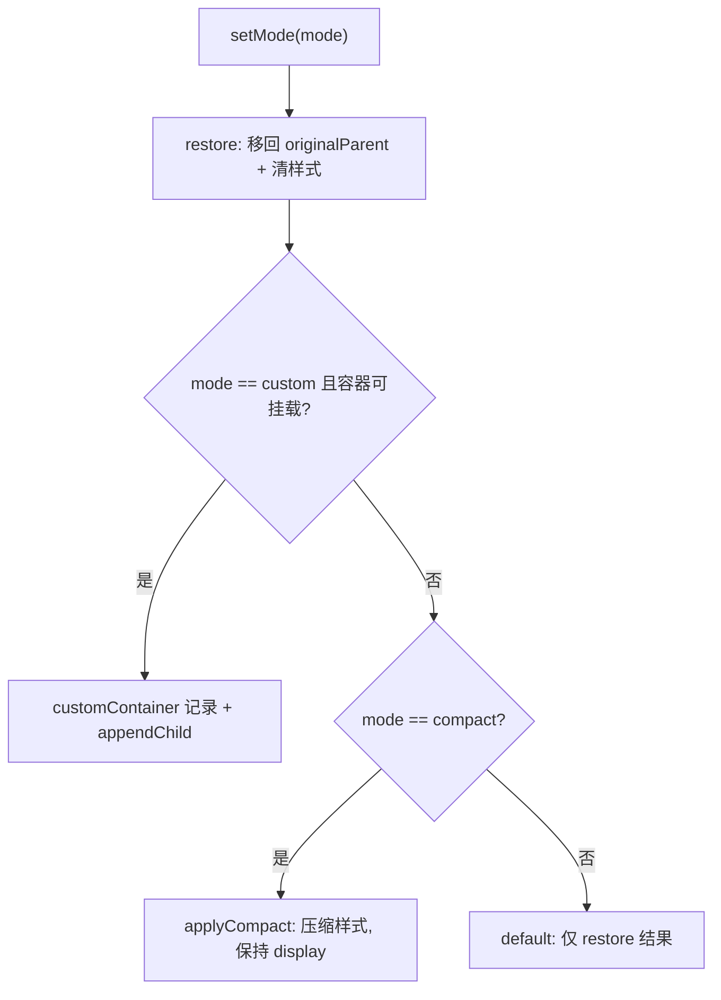

# Design Document

## Overview

重构 `CreditManager`（`packages/engine-cesium/src/credits.ts`），把版权展示拆成两个正交状态：

- **位置**：容器位于原始父节点、自定义容器、或保持原位。
- **布局**：默认布局或压缩布局（不改变可见性）。

每次 `setMode` 先执行一次 `restore()` 归零（移回原始父节点 + 清除本管理器施加的内联样式），再按目标模式施加最小改动，从而保证模式切换可逆、位置与样式不残留。



## Components and Interfaces

### CreditManager

字段：

- `mode: CreditMode`（默认 `"default"`）
- `customContainer: Element | undefined`
- `creditContainer: HTMLElement`（构造时缓存 `viewer.cesiumWidget.creditContainer`）
- `originalParent: Node | undefined`（构造时 `creditContainer.parentNode`）
- `baselineDisplay: string`（构造时 `creditContainer.style.display ?? ""`）

方法：

```ts
setMode(mode: CreditMode, container?: Element): void {
  this.restore()
  this.mode = mode
  this.customContainer = undefined
  if (mode === "custom" && isMountable(container)) {
    this.customContainer = container
    container.appendChild(this.creditContainer)
    return
  }
  if (mode === "compact") this.applyCompact()
}

getMode(): CreditMode
getContainer(): Element | undefined  // customContainer ?? creditContainer

private applyCompact(): void   // 设置 fontSize / lineHeight / padding
private restore(): void        // 移回 originalParent，display 恢复基线，清压缩样式
```

### 挂载能力判定

```ts
function isMountable(value: Element | undefined): value is Element {
  return (
    value !== undefined &&
    typeof (value as Element).appendChild === "function" &&
    typeof (value as Element).removeChild === "function"
  )
}
```

要点：用「是否具备节点挂载能力」替代 `container instanceof HTMLElement`，既能在无 DOM 的测试环境判定，也能接受 `SVGElement` 等非 `HTMLElement` 的合法 `Element`。`custom` 未提供可挂载容器时自然落入 `default` 表现（不移动、不压缩）。

### 压缩样式

压缩只改变占位，不改可见性：`fontSize: "10px"`、`lineHeight: "1.2"`、`padding: "2px 4px"`。`restore()` 将这三项清空并把 `display` 恢复为 `baselineDisplay`。不再出现把整个版权区域 `display: none` 的分支。

## Testing Strategy

新增 `tests/unit/engine-credits.test.ts`，用最小假 DOM（支持 `style`、`parentNode`、`appendChild`、`removeChild`）与假 viewer，覆盖：

- `compact` 保持 `display !== "none"`、应用压缩样式、位置不变。
- `custom` 挂载到自定义容器、`getContainer()` 返回自定义容器；切回 `default` 恢复原始父节点与样式。
- 完整流程 `default → custom → compact → default` 每步位置正确、最终回到原始父节点。
- 保留构造时既有的 `display: block` 基线。
- `custom` 无可用容器时回退为原位。

## Risks and Mitigations

- **Cesium 自身对容器 display 的管理**：`restore()` 恢复的是构造时捕获的基线值，若 Cesium 后续因无 credits 自行隐藏，本管理器不回写冲突，仅在 `setMode` 时归位。
- **原始父节点缺失**（构造时容器尚未挂载）：`originalParent` 为 `undefined` 时跳过移动，`custom` 仍可挂载；属边界情况，不改变常规路径。
