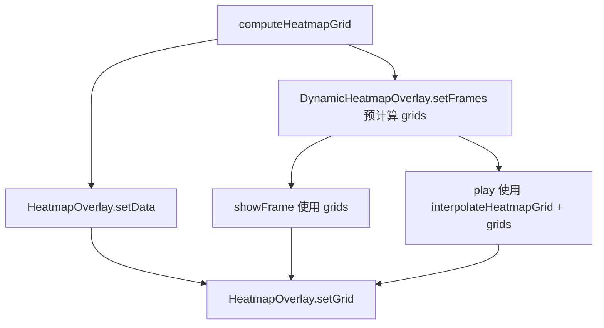

# Design Document

## Overview

修复 `DynamicHeatmapOverlay` 预计算网格与插值能力未被使用的问题：把「渲染」与「网格计算」解耦，让帧渲染与播放都直接消费缓存网格，播放时在相邻网格之间插值。改动集中在 `heatmap-overlay.ts` 与 `dynamic-heatmap.ts`，不改变既有公共签名语义。

组件关系：



## Components and Interfaces

### HeatmapOverlay（heatmap-overlay.ts）

把原有「计算网格 + 绘制」合并逻辑拆为「计算」与「绘制」两步：

```ts
setData(points: HeatmapPoint[], options: HeatmapRenderOptions = {}): void {
  this.context.lifecycle.assertUsable("render heatmap")
  this.setGrid(computeHeatmapGrid(points, options), options)
}

setGrid(grid: HeatmapGrid, options: HeatmapRenderOptions = {}): void {
  this.context.lifecycle.assertUsable("render heatmap")
  const pixels = gridToRgba(grid, options.gradient ?? DEFAULT_HEATMAP_GRADIENT)
  // canvas + ImageMaterialProperty + entity（与既有实现相同）
}
```

属性：

- `setData` 保留生命周期断言，保证 `points` 非法与上下文不可用两种情况下的既有错误优先级。
- `setGrid` 复用既有绘制逻辑，唯一区别是网格来源为入参，不做计算。
- 新增 `HeatmapGrid` 类型导入。

### DynamicHeatmapOverlay（dynamic-heatmap.ts）

新增过渡步数常量与插值播放：

```ts
const DEFAULT_TRANSITION_STEPS = 12

showFrame(index: number): void {
  if (this.frames.length === 0) return
  this.current = ((index % this.frames.length) + this.frames.length) % this.frames.length
  this.overlay.setGrid(this.grids[this.current], this.frames[this.current].options)
}

play(intervalMs = 500, steps = DEFAULT_TRANSITION_STEPS): void {
  this.pause()
  if (this.frames.length < 2) return
  const duration = Math.max(16, intervalMs)
  const stepMs = Math.max(16, Math.round(duration / Math.max(2, Math.floor(steps))))
  let elapsed = 0
  this.timer = setInterval(() => {
    elapsed += stepMs
    const from = this.current
    const to = (from + 1) % this.frames.length
    const ratio = Math.min(1, elapsed / duration)
    if (ratio >= 1) {
      this.overlay.setGrid(this.grids[to], this.frames[to].options)
      this.current = to
      elapsed = 0
      return
    }
    this.overlay.setGrid(
      interpolateHeatmapGrid(this.grids[from], this.grids[to], ratio),
      this.frames[from].options,
    )
  }, stepMs)
}
```

设计要点：

- `current` 表示当前过渡的起始帧；`ratio >= 1` 时渲染目标帧、`current` 前进、`elapsed` 归零，形成连续过渡。
- 维度不一致时 `interpolateHeatmapGrid` 返回起始网格（既有语义），区间结束时仍以目标帧硬切，保证不丢帧。
- 过渡期间的渲染选项取起始帧，避免逐帧独立选项造成的歧义（见 Out of Scope）。
- `setFrames` / `clear` 保持既有网格缓存与清理行为。

## Testing Strategy

现有 `tests/unit/analysis-heatmap.test.ts` 已覆盖 `computeHeatmapGrid` / `gridToRgba` / `interpolateHeatmapGrid`（纯函数）。`HeatmapOverlay` / `DynamicHeatmapOverlay` 依赖 `document` 与 Cesium viewer，在 node 测试环境不可直接渲染，因此：

- 不新增需要 DOM 的用例。
- 通过既有 `interpolateHeatmapGrid` 用例保证插值数学正确性。
- 行为回归由 typecheck / 全量测试 / build / 门禁覆盖。

## Risks and Mitigations

- **渲染图元在过渡期内被重建**：沿用既有 `setGrid` 的「清理并新增实体」策略，未引入图元复用；过渡步数默认 12，可按需通过 `play` 的第二个参数调低以减少重建次数。
- **维度不一致导致插值退化**：`interpolateHeatmapGrid` 的既有回退保证不抛错；播放仍在区间结束时切换帧。
