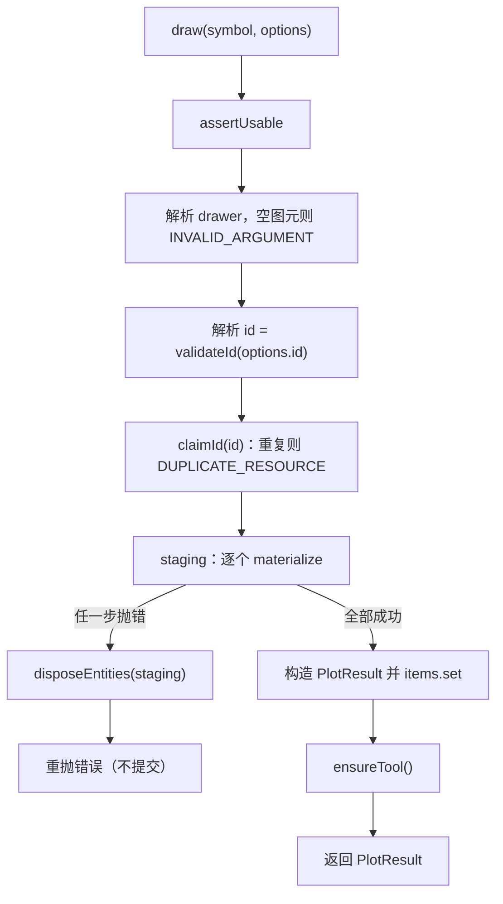

# PlottingManager 标绘创建的 ID 校验与原子化

Feature Name: plot-draw-atomicity
Updated: 2026-10-16

## Description

为 `@arc3dlab/plotting` 的 `PlottingManager.draw()`（`packages/plotting/src/plotting-manager.ts`）建立原子化创建语义：

- 在创建任何原生实体之前校验结果 ID：重复抛 `DUPLICATE_RESOURCE`，显式空 ID 抛 `INVALID_ARGUMENT`。
- 创建过程使用暂存集合累积实体，全部成功后再构造并提交 `PlotResult` 记录。
- 任一实体创建失败时，回滚本次已创建的全部实体、不写入记录，并原样重抛错误。
- 统一 `remove()` 与回滚的实体移除路径。

需求见 `.monkeycode/specs/2026-10-16-plot-draw-atomicity/requirements.md`。

## Architecture



校验顺序固定为「几何合法性 → ID → 实体创建」，保证任何失败都发生在状态变更之前，或已经在暂存集合范围内可回滚。

## Components and Interfaces

### `draw()` 调整

公共签名不变：`draw(symbol: PlotSymbol, options: PlotDrawOptions): PlotResult`。内部流程：

```ts
draw(symbol: PlotSymbol, options: PlotDrawOptions): PlotResult {
  this.context.lifecycle.assertUsable("draw plot")
  const drawer = SYMBOL_DRAWERS[symbol]
  if (!drawer) throw new Arc3DError("INVALID_ARGUMENT", `Unknown plot symbol: ${symbol}`)

  const positions = options.positions ?? []
  const anchorPoints: PlotPoint[] = positions.map((point) => [point.longitude, point.latitude])
  const shapes = drawer({ positions: anchorPoints, options })
  if (shapes.length === 0) {
    throw new Arc3DError("INVALID_ARGUMENT", `Symbol ${symbol} requires more anchor positions`)
  }

  const id = this.resolveId(options.id)
  this.claimId(id)

  const style: PlotStyle = options.style ?? {}
  const entities: unknown[] = []
  try {
    for (const shape of shapes) entities.push(this.materialize(shape, style, options))
  } catch (error) {
    this.disposeEntities(entities)
    throw error
  }

  const result: PlotResult = { id, symbol, positions, shapes, entities }
  this.items.set(id, result)
  this.ensureTool()
  return result
}
```

### 新增私有方法

```ts
private resolveId(provided?: string): string   // 空字符串 → INVALID_ARGUMENT；否则 ?? createId("plot")
private claimId(id: string): void               // items 已存在 → DUPLICATE_RESOURCE
private disposeEntities(entities: unknown[]): void   // 统一实体移除（容错 viewer 缺失）
```

### `remove()` 复用

`remove()` 改为调用 `disposeEntities(result.entities)`，与回滚路径共享同一实现，避免移除逻辑分散。

## Data Models

### ID 校验规则

| 输入 | 行为 |
| --- | --- |
| `options.id` 未提供 | `createId("plot")` 自动生成 |
| `options.id` 为非空字符串且未占用 | 采用该值 |
| `options.id` 为非空字符串但已存在 | 抛 `Arc3DError("DUPLICATE_RESOURCE")` |
| `options.id === ""` | 抛 `Arc3DError("INVALID_ARGUMENT")` |

校验发生在 `materialize` 之前，因此重复或空 ID 不产生任何实体。

### 暂存与提交

- `entities: unknown[]` 是本地暂存集合，仅累积本次创建成功的原生对象。
- 全部成功后才构造 `PlotResult` 并 `items.set(id, result)`，该写入是对外可见的原子提交点。
- `shapes` 与 `positions` 是纯计算结果，失败时随栈帧丢弃，无需回滚。

## Correctness Properties

1. **前置校验**：ID 校验与几何校验都发生在首次 `materialize` 之前，失败时不产生实体。
2. **原子提交**：`items` 只在全部实体创建成功后写入一次；不存在写入部分结果的路径。
3. **失败回滚**：创建中途失败时，暂存集合中的每个实体都被移除。
4. **记录唯一**：同一 ID 不会被覆盖；`items` 中每个 ID 对应一次成功提交。
5. **行为兼容**：未知符号、锚点不足的既有错误语义不变；成功路径返回值结构不变。

## Error Handling

- 未知符号：`Arc3DError("INVALID_ARGUMENT")`。
- 锚点不足（`shapes.length === 0`）：`Arc3DError("INVALID_ARGUMENT")`。
- 空 ID：`Arc3DError("INVALID_ARGUMENT")`。
- 重复 ID：`Arc3DError("DUPLICATE_RESOURCE")`。
- 实体创建失败（例如 `viewer.entities.add` 抛错）：回滚暂存实体后原样重抛原始错误（不使用 `Arc3DError` 包装，保留根因）。
- `lifecycle` 不可用：沿用 `context.lifecycle.assertUsable("draw plot")`。

## Test Strategy

在 `tests/unit/plotting.test.ts` 扩充 `PlottingManager` 用例，`makeContext()` 支持注入「第 N 次 `entities.add` 抛错」的行为：

- 覆盖：重复 ID 抛 `DUPLICATE_RESOURCE`，既有记录与其实体不受影响，且不新增实体。
- 覆盖：显式空 ID 抛 `INVALID_ARGUMENT`，不新增实体、不写入记录。
- 覆盖：多图元符号（如 `circle`）在第 2 个实体创建失败时，已创建实体被回滚，`results` 不含该记录，异常原样抛出。
- 覆盖：正常多图元绘制成功后实体数与 `entities.length` 一致，`remove()` / `removeAll()` 完整清理。
- 覆盖：既有自动生成 ID、未知符号、锚点不足用例保持通过。

## Decision Log

- **重复 ID 抛错而非替换**：与 `GraphicManager.claimId` 的 `DUPLICATE_RESOURCE` 语义一致，避免覆盖记录导致的孤儿实体。
- **空 ID 抛 `INVALID_ARGUMENT`**：显式空字符串当作调用方错误，避免 `""` 与自动生成 ID 语义混淆。
- **不接入共享 `ResourceRegistry`**：`PlotResult` 非 `ResourceHandle`，且 `PlottingManager.destroy()` 已由 `Arc3DApp` 生命周期统一调用；本次仅修复记录与回滚，不扩大改造范围。
- **回滚原样重抛**：保留实体创建失败的根因错误类型，便于诊断。
- **回滚容错**：`disposeEntities` 经 `viewerOrUndefined()` 获取视图，视图在创建失败期间不可用时跳过移除而不二次抛错。

## References

[^1]: (File#L76-L83) - `draw()` 先 `materialize` 后写 `items`，无回滚、可覆盖（packages/plotting/src/plotting-manager.ts）
[^2]: (File#L78-L86) - `GraphicManager.claimId` 以 `DUPLICATE_RESOURCE` 预校验 ID 的既有约定（packages/graphics/src/graphic-manager.ts）
[^3]: (File#L62-L67) - `areaShape` 面状符号产出面与轮廓两个图元，是中途失败的典型场景（packages/plotting/src/symbols/types.ts）
[^4]: (File#L111-L121) - `remove()` 既有实体移除路径，作为 `disposeEntities` 抽取来源（packages/plotting/src/plotting-manager.ts）
