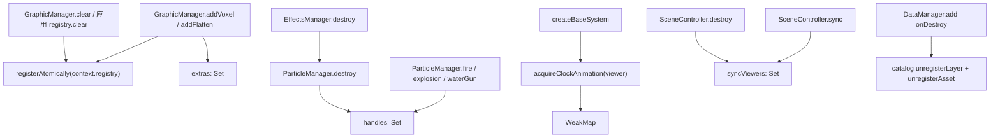

# 资源生命周期与状态管理统一合同

Feature Name: resource-ownership
Updated: 2026-10-16

## Description

为 Arc3D SDK 建立三类资源的统一所有权与释放合同，修复六处契约级缺陷：

1. 体素/压平对象纳入共享 `ResourceRegistry` 与 `GraphicManager` 生命周期。
2. 粒子句柄纳入 `ParticleManager`/`EffectsManager` 生命周期。
3. `viewer.clock.shouldAnimate` 覆盖以引用计数管理并在归零时恢复。
4. `SyncViewer` 由 `SceneController` 跟踪并随场景销毁释放。
5. `DataManager.add()` 句柄销毁时注销资产元数据。
6. `ManagedGraphic.positions` 返回防御性副本。

需求见 `.monkeycode/specs/2026-10-16-resource-ownership/requirements.md`。

已确认决策：

- **D1**：`MultiTileVoxel` / `ModelFlatten` 实现 `ResourceHandle`，由 `GraphicManager` 登记进共享 `ResourceRegistry`。
- **D2**：`EffectsManager`/`ParticleManager` 托管粒子句柄并统一释放；`shouldAnimate` 以引用计数覆盖、归零恢复。
- **D3**：`SyncViewer` 跟踪、`DataManager` 资产注销、`ManagedGraphic.positions` 副本一并纳入本迭代。

## Architecture



沿用既有基础设施：`ResourceRegistry`（登记与释放）、`registerAtomically`（原子登记并回滚）、`WeakMap`（按 Viewer 隔离共享状态），不新增独立清理机制。

## Components and Interfaces

### 1. `MultiTileVoxel` 实现 `ResourceHandle`（`packages/graphics/src/voxel.ts`）

```ts
export class MultiTileVoxel implements ResourceHandle<VoxelPrimitive | PointPrimitiveCollection | undefined> {
  readonly id: string = createId("voxel")
  readonly type = "voxel"
  owned = true
  get native() { return this.primitive ?? this.pointCollection }
  get visible() { return this.primitive?.show ?? this.pointCollection?.show ?? false }
  set visible(value) { if (this.primitive) this.primitive.show = value; if (this.pointCollection) this.pointCollection.show = value }
  // destroy() 已幂等：移除并置空图元与点集合
}
```

### 2. `ModelFlatten` 实现 `ResourceHandle`（`packages/graphics/src/flatten.ts`）

```ts
export class ModelFlatten implements ResourceHandle<ClippingPolygonCollection> {
  readonly id: string = createId("flatten")
  readonly type = "flatten"
  owned = true
  get native() { return this.collection }
  get visible() { return this.collection.enabled }
  set visible(value) { this.collection.enabled = value }
  // destroy() 保持：仅当 target.clippingPolygons 仍指向自有集合时解除关联
}
```

### 3. `GraphicManager` 登记与释放（`packages/graphics/src/graphic-manager.ts`）

```ts
private extras = new Set<string>()

addVoxel(pointData, options?): MultiTileVoxel {
  this.context.lifecycle.assertUsable("add voxel")
  return this.trackExtra(new MultiTileVoxel(this.context, pointData, options))
}

addFlatten(target?, options?): ModelFlatten {
  this.context.lifecycle.assertUsable("add flatten")
  return this.trackExtra(new ModelFlatten(this.context, target, options))
}

private trackExtra<T extends ResourceHandle>(extra: T): T {
  registerAtomically(this.context.registry, extra, () => extra.destroy())
  this.extras.add(extra.id)
  return extra
}

clear(): void {
  for (const graphic of Array.from(this.items.values())) graphic.destroy()
  for (const id of Array.from(this.extras)) this.context.registry.remove(id)
  this.extras.clear()
}
```

`assertUsable` 失败即抛 `APP_DESTROYED`（Requirement 1.4）。`registry.remove` 对 `owned` 资源调用 `destroy()`，`extras` 从登记表移除，避免悬挂句柄。

### 4. 粒子时钟引用计数（`packages/effects/src/particles.ts`）

```ts
const clockOverrides = new WeakMap<Viewer, { original: boolean; count: number }>()

function acquireClockAnimation(viewer: Viewer): () => void {
  const entry = clockOverrides.get(viewer)
  if (entry) entry.count += 1
  else {
    clockOverrides.set(viewer, { original: viewer.clock.shouldAnimate, count: 1 })
    viewer.clock.shouldAnimate = true
  }
  let released = false
  return () => {
    if (released) return
    released = true
    const current = clockOverrides.get(viewer)
    if (!current) return
    current.count -= 1
    if (current.count <= 0) {
      viewer.clock.shouldAnimate = current.original
      clockOverrides.delete(viewer)
    }
  }
}
```

`createBaseSystem()` 在改写前调用 `acquireClockAnimation(viewer)`，并把释放函数并入 `ParticleHandle` 的 `detach`（与 `releaseRender()` 一起），保证销毁时恢复。未创建粒子时 `WeakMap` 为空，不触碰时钟。

### 5. `ParticleManager` 托管（`packages/effects/src/particles-manager.ts`）

```ts
private handles = new Set<ParticleHandle>()
get size(): number { return this.handles.size }
private track(handle: ParticleHandle): ParticleHandle { this.handles.add(handle); return handle }
destroy(): void {
  for (const handle of Array.from(this.handles)) {
    try { handle.destroy() } catch (error) { this.context.logger.error("Failed to destroy particle", error) }
  }
  this.handles.clear()
}
```

`fire` / `explosion` / `waterGun` 的返回值经 `track()`。`EffectsManager.destroy()` 追加 `this.particles.destroy()`。

### 6. `SceneController` 跟踪联动（`packages/scene/src/scene-controller.ts`）

```ts
private readonly syncViewers = new Set<SyncViewer>()

sync(views: SyncableView[]): SyncViewer {
  const viewer = this.viewer()
  const syncViewer = new SyncViewer({ camera: viewer.camera as SyncableCamera }, views)
  this.syncViewers.add(syncViewer)
  return syncViewer
}

destroy(): void {
  this.cancelMorph?.()
  this.cancelMorph = undefined
  for (const syncViewer of this.syncViewers) syncViewer.destroy()
  this.syncViewers.clear()
  this.postRender.destroy()
}
```

`destroy()` 保持幂等（`SyncViewer.destroy` 与 `PostRenderController.destroy` 均已幂等），兼容 `disposers` 与应用级两步销毁。

### 7. `DataManager` 资产注销（`packages/data/src/index.ts`）

句柄 `onDestroy` 增加 `this.context.catalog.unregisterAsset(id)`；`registry.add(handle)` 失败回滚分支同样注销图层与资产。加载失败时保留一致的失败记录（图层 `failed` + 资产），不产生悬挂引用。

### 8. `ManagedGraphic.positions` 副本（`packages/graphics/src/managed-graphic.ts`）

```ts
constructor(...) {
  this.currentPositions = positions.map((position) => ({ ...position }))
}
get positions(): LngLatHeight[] {
  return this.currentPositions.map((position) => ({ ...position }))
}
```

`setPositions()` 经 `toLngLatHeights()` 已生成新对象，保持现状。

## Data Models

| 资源类别 | 登记位置 | 释放入口 | 幂等要求 |
| --- | --- | --- | --- |
| `ManagedGraphic` | `context.registry` | 自身 `destroy()` / `GraphicManager.clear()` / `registry.clear()` | 是 |
| `MultiTileVoxel` / `ModelFlatten` | `context.registry` + `GraphicManager.extras` | 自身 `destroy()` / `GraphicManager.clear()` / `registry.clear()` | 是 |
| `ParticleHandle` | `ParticleManager.handles` | 自身 `destroy()` / `EffectsManager.destroy()` | 是 |
| `SyncViewer` | `SceneController.syncViewers` | 自身 `destroy()` / `SceneController.destroy()` | 是 |
| `shouldAnimate` 覆盖 | `WeakMap<Viewer>` | 引用计数归零 | 是 |
| 数据资产 | `context.catalog.assets` | `DataManager` 句柄 `onDestroy` | 是 |

## Correctness Properties

1. **完整性**：所有 SDK 创建的运行时资源都存在至少一个统一释放入口。
2. **幂等性**：单对象重复 `destroy()` 与应用级销毁叠加调用均安全。
3. **最小侵入**：未创建资源时不改写共享状态；`ModelFlatten` 不覆盖外部替换后的裁剪集合引用。
4. **可恢复性**：`shouldAnimate` 在最后一个粒子释放后回到原值。
5. **一致性**：`DataManager` 资产与图层元数据同生共死。

## Error Handling

- 应用已销毁：`GraphicManager.addVoxel` / `addFlatten` 抛 `Arc3DError("APP_DESTROYED")`。
- 登记冲突：`registerAtomically` 回滚（销毁新建对象），不留下未登记资源。
- 释放异常：`ParticleManager.destroy` 单句柄失败经 `logger.error` 上报，不中断其余释放。
- 资产回滚：`registry.add` 失败时同步注销图层与资产后重抛。

## Test Strategy

新增/扩展单元测试：

- `tests/unit/graphics-resource-ownership.test.ts`：`addVoxel`/`addFlatten` 登记进 registry；`clear()` 释放并清理 extras；重复 `destroy()` 幂等；应用销毁后调用抛 `APP_DESTROYED`；`ModelFlatten` 不覆盖外部集合。
- `tests/unit/effects-particles-manager.test.ts`（扩展）：`ParticleManager.destroy()` 释放全部句柄；`clock.shouldAnimate` 创建时覆盖、全部销毁后恢复原值；多粒子引用计数。
- `tests/unit/scene-sync-shotgrid.test.ts`（扩展）：`SceneController.destroy()` 解除 `SyncViewer` 相机监听。
- `tests/unit/data-manager-ownership.test.ts`：`DataManager.add()` 句柄销毁注销图层与资产；登记失败回滚。

## References

[^1]: (File#L113) - `addVoxel` / `addFlatten` 未登记（packages/graphics/src/graphic-manager.ts）
[^2]: (File#L126) - `EffectsManager.destroy` 未释放粒子（packages/effects/src/index.ts）
[^3]: (File#L286) - `createBaseSystem` 强制覆盖时钟（packages/effects/src/particles.ts）
[^4]: (File#L155) - `SceneController.sync` 返回未跟踪的 `SyncViewer`（packages/scene/src/scene-controller.ts）
[^5]: (File#L120) - `DataManager.add` 句柄未注销资产（packages/data/src/index.ts）
[^6]: (File#L55) - `ManagedGraphic.positions` 暴露内部引用（packages/graphics/src/managed-graphic.ts）
