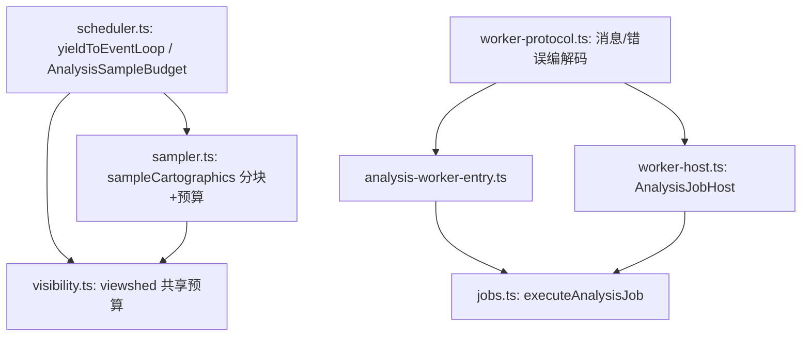

# Design Document

## Overview

本设计在 `@arc3dlab/analysis` 内补齐三块互相独立但同属「分块分析执行质量」的能力：块间真实让出、任务级累计采样预算、真实 Worker 作业执行。三者共享一条原则——保持既有公共行为兼容，缺省路径更安全（默认真实让出、缺省不抛预算错误、无 Worker 时降级），新增能力通过可选入口启用。

组件关系：



## Components and Interfaces

### scheduler.ts

新增让出与预算两个基础设施，并让 `mapInChunks` 复用。

```ts
/** 块间让出策略。 */
export type YieldStrategy = "macrotask" | "microtask"

/**
 * 在分块计算之间让出控制权。
 * 缺省使用宏任务让出（MessageChannel，不可用时 setTimeout(0)）。
 */
export function yieldToEventLoop(strategy: YieldStrategy = "macrotask"): Promise<void>

/**
 * 任务级累计采样预算。
 */
export class AnalysisSampleBudget {
  readonly maxSamples: number
  constructor(maxSamples?: number)
  get used(): number
  get remaining(): number
  /** 请求 count 个采样；超过剩余额度时抛 INVALID_ARGUMENT。 */
  reserve(count: number): number
}
```

`AnalysisTaskOptions` 增加两个可选字段：

```ts
export interface AnalysisTaskOptions {
  signal?: AbortSignal
  onProgress?: (progress: AnalysisProgress) => void
  maxSamples?: number
  /** 任务级共享采样预算；省略时由调用方按单次 maxSamples 自行构造。 */
  sampleBudget?: AnalysisSampleBudget
  /** 块间让出策略；缺省宏任务。 */
  yieldStrategy?: YieldStrategy
}
```

`mapInChunks` 的块尾由 `await Promise.resolve()` 改为 `await yieldToEventLoop(options?.yieldStrategy)`。

`yieldToEventLoop` 实现要点：

```ts
async function yieldMacrotask(): Promise<void> {
  if (typeof MessageChannel !== "undefined") {
    await new Promise<void>((resolve) => {
      const channel = new MessageChannel()
      channel.port1.onmessage = () => {
        channel.port1.close()
        resolve()
      }
      channel.port2.postMessage(undefined)
    })
    return
  }
  await new Promise<void>((resolve) => setTimeout(resolve, 0))
}
```

属性说明：

- 无可配置状态；`strategy === "microtask"` 时执行 `await Promise.resolve()`。
- `MessageChannel` 在浏览器与 Node 15+ 均可用；缺失时回退 `setTimeout(0)`，两者都进入下一轮事件循环。

### sampler.ts

`sampleCartographics` 的同步 `getHeight` 循环改为分块并让出，同时消费预算。

```ts
const budget = options?.sampleBudget ??
  new AnalysisSampleBudget(options?.maxSamples ?? cartos.length)
const requested = cartos.length
const limited = cartos.slice(
  0,
  clampSampleCount(requested, options?.maxSamples ?? requested),
)
budget.reserve(limited.length)
const clones = limited.map((item) => item.clone())
// ...sampleHeightMostDetailed（保持不变）
const out: SampledHeight[] = []
for (let offset = 0; offset < limited.length; offset += DEFAULT_CHUNK_SIZE) {
  const end = Math.min(limited.length, offset + DEFAULT_CHUNK_SIZE)
  for (let index = offset; index < end; index += 1) {
    // ...解析并 push
  }
  await yieldToEventLoop(options?.yieldStrategy)
}
return out
```

关键决策：

- 未提供共享预算时，预算上限取「本次坐标数」，因此 `reserve(limited.length)` 恒不超限，保持既有单次截断（`clampSampleCount`）行为与返回值。
- 提供共享预算时，`limited.length` 计入累计；累计超限即抛错。

### visibility.ts

- 新增私有 `computeLineOfSight(options, budget?)`，公共 `lineOfSight()` 直接转发（签名不变）。
- `viewshed()` 在开始时创建共享预算：

```ts
const budget = new AnalysisSampleBudget(options.maxSamples ?? DEFAULT_MAX_SAMPLES)
```

- 观察点采样与每条射线都复用该预算：观察点通过 `{ signal, onProgress, maxSamples, sampleBudget: budget }` 传入；射线通过 `computeLineOfSight({...}, budget)` 传入。
- `mapInChunks` 继续负责射线层让出，缺省宏任务。

预算耗尽时 `reserve` 抛出的 `INVALID_ARGUMENT` 会经 `mapInChunks` -> `viewshed` 冒泡；在 `viewshedTask` 路径下由 `runAnalysisTask` 记录为 `failed`，错误码保留。

### worker-protocol.ts（新增）

收纳跨线程协议与错误编解码，供宿主与 Worker 共享，避免 `worker-host` 与 Worker 入口形成循环依赖。

```ts
export interface SerializedAnalysisError { code: string; message: string }
export interface AnalysisWorkerRequest { id: number; job: AnalysisJob }
export type AnalysisWorkerResponse =
  | { id: number; result: AnalysisJobResult }
  | { id: number; error: SerializedAnalysisError }

export function serializeAnalysisError(error: unknown): SerializedAnalysisError
export function restoreAnalysisError(payload: SerializedAnalysisError): Arc3DError

/** 宿主消费的最小 Worker 接口（便于测试注入）。 */
export interface AnalysisWorkerLike {
  postMessage(message: unknown): void
  terminate(): void
  onmessage: ((event: { data: unknown }) => void) | null
  onerror: ((event: unknown) => void) | null
}
export type AnalysisWorkerFactory = () => AnalysisWorkerLike | undefined
```

公开导出 `serializeAnalysisError` / `restoreAnalysisError` 仍从 `worker-host.ts` 转出，保持既有导入路径不变。

### analysis-worker-entry.ts（新增）

Worker 入口：接收 `AnalysisWorkerRequest`，调用 `executeAnalysisJob`，回传结果或序列化错误。

```ts
self.onmessage = (event) => {
  const { id, job } = event.data as AnalysisWorkerRequest
  try {
    postMessage({ id, result: executeAnalysisJob(job) })
  } catch (error) {
    postMessage({ id, error: serializeAnalysisError(error) })
  }
}
```

### worker-host.ts（改造）

`AnalysisJobHost` 改为「优先 Worker，失败降级」的宿主。

```ts
export interface AnalysisJobHostOptions {
  /** 进程内执行器，缺省 executeAnalysisJob。 */
  execute?: (job: AnalysisJob) => AnalysisJobResult
  /** Worker 工厂；缺省在可用时创建 ES 模块 Worker。 */
  createWorker?: AnalysisWorkerFactory
}
```

类内状态与流程：

- `ensureWorker()`：惰性创建；`createWorker()` 返回 `undefined` 或抛错时置 `workerUnavailable` 并永久降级。
- 创建成功后挂接常驻 `onmessage`/`onerror`，按 `id` 路由到 `pending`。
- `run(job, options)`：
  1. 已销毁或信号已中止 -> `CANCELLED`；
  2. `structuredClone(job)` 校验可克隆性，失败 -> `INVALID_FORMAT`（`structuredClone` 缺失时跳过校验）；
  3. 无 Worker -> 进程内执行（保留现有 `queueMicrotask` + 中止检查语义）；
  4. 有 Worker -> `postMessage`，按 `id` 等待结果；错误经 `restoreAnalysisError` 还原。
- 取消：`AbortSignal` 触发时 `terminate()` 当前 Worker、以 `CANCELLED` 拒绝所有 `pending`、清空并允许下次重建 Worker。
- `destroy()`：置 `terminated`、`terminate()`、以 `CANCELLED` 拒绝所有 `pending`。
- Worker `onerror`：以 `ENGINE_FAILURE` 拒绝所有 `pending`，并将 Worker 标记为不可用（避免反复失败）。

默认 Worker 工厂：

```ts
function createDefaultWorker(): AnalysisWorkerLike | undefined {
  if (typeof Worker === "undefined") return undefined
  try {
    return new Worker(
      new URL("./analysis-worker-entry.ts", import.meta.url),
      { type: "module" },
    ) as unknown as AnalysisWorkerLike
  } catch {
    return undefined
  }
}
```

### vite.config.ts

为 Worker 增加 ES 模块产物配置，与 `type: "module"` 保持一致：

```ts
worker: { format: "es" },
```

## Error Handling

| 场景 | 错误码 | 触发点 |
| --- | --- | --- |
| 累计采样超过任务预算 | `INVALID_ARGUMENT` | `AnalysisSampleBudget.reserve` |
| 作业输入不可结构化克隆 | `INVALID_FORMAT` | `AnalysisJobHost.run` |
| 作业被取消 / 宿主销毁 | `CANCELLED` | `AnalysisJobHost.run` / `destroy` |
| Worker 运行错误且未携带码 | `ENGINE_FAILURE` | `AnalysisJobHost` Worker `onerror` |

跨线程错误码通过 `serializeAnalysisError` / `restoreAnalysisError` 往返保留。

## Testing Strategy

- `tests/unit/analysis-scheduler.test.ts`（新增）：
  - `AnalysisSampleBudget` 的 `reserve` 累加、超限抛 `INVALID_ARGUMENT`、超限不修改 `used`、`remaining` 正确。
  - `yieldToEventLoop()` 的 `macrotask` 让出可被 `setTimeout(0)` 观察（宏任务让出会晚于同轮微任务）；`microtask` 让出在本轮微任务队列内完成。
- `tests/unit/analysis-worker.test.ts`（扩展）：
  - 注入假 Worker（记录投递、可控回包）验证：成功回包经 `id` 路由、错误回包还原为 `Arc3DError` 且保留码、取消触发 `terminate` 并 `CANCELLED`。
  - 不可克隆输入（含函数）-> `INVALID_FORMAT`。
  - 无 `Worker` 环境保持既有进程内行为（既有用例）。
- `tests/unit/analysis-visibility.test.ts`（扩展）：
  - 以较小 `maxSamples` 触发可视域共享预算超限，断言抛出 `INVALID_ARGUMENT`。
  - 覆盖 `sampleCartographics` 分块在多种坐标数下返回顺序与长度不变。

## Risks and Mitigations

- **宏任务让出的开销**：每块一次 `MessageChannel` 往返。块大小（`DEFAULT_CHUNK_SIZE=256`）使 1 万采样约 40 次让出，可接受；需要时可切 `microtask`。
- **Worker 打包**：`new URL(..., import.meta.url)` 依赖打包器识别 Worker 语法。通过 `worker.format: "es"` 与构建验证兜底；若产物不支持，运行时降级为进程内。
- **行为兼容**：自动构造的预算上限取本次坐标数，保证未使用共享预算的调用不产生新的超限错误。
