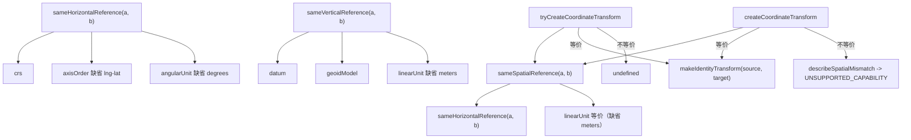

# 空间参考等价性分层与单位校验

Feature Name: spatial-unit-equivalence
Updated: 2026-10-16

## Description

重构 `packages/core/src/spatial.ts` 的空间参考等价性判断，严格区分三个层次：

- **坐标系识别 + 单位等价**：`sameHorizontalReference()` 比较水平方向的 `crs` / `axisOrder` / `angularUnit`；`sameVerticalReference()` 比较垂直方向的 `datum` / `geoidModel` / `linearUnit`。
- **完整等价**：`sameSpatialReference()` = 水平等价 且 高程长度单位 `linearUnit` 等价。
- **真实坐标变换**：仅当完整等价时返回恒等转换；`tryCreateCoordinateTransform()` 在不完全等价时返回 `undefined`，新增 `createCoordinateTransform()` 则抛 `Arc3DError("UNSUPPORTED_CAPABILITY")` 并点明不一致层次。

需求见 `.monkeycode/specs/2026-10-16-spatial-unit-equivalence/requirements.md`。

## Architecture



三个判断函数各自独立，`tryCreateCoordinateTransform` / `createCoordinateTransform` 都以 `sameSpatialReference` 作为「可返回恒等变换」的唯一依据。

## Components and Interfaces

### 调整的函数

```ts
// 语义修正：新增线性单位比较
export function sameSpatialReference(a: SpatialReference, b: SpatialReference): boolean

// 语义修正：恒等转换携带真实的 source / target
export function tryCreateCoordinateTransform(
  source: SpatialReference,
  target: SpatialReference,
): CoordinateTransform | undefined
```

### 新增的函数

```ts
export function sameHorizontalReference(a: SpatialReference, b: SpatialReference): boolean
export function sameVerticalReference(a: VerticalReference, b: VerticalReference): boolean
export function createCoordinateTransform(
  source: SpatialReference,
  target: SpatialReference,
): CoordinateTransform
```

### 内部辅助

```ts
function makeIdentityTransform(source: SpatialReference, target: SpatialReference): CoordinateTransform
function describeSpatialMismatch(a: SpatialReference, b: SpatialReference): string
```

`identityTransform(reference)` 改为 `makeIdentityTransform(reference, reference)`，保持既有行为。

### 关键实现

```ts
export function sameHorizontalReference(a, b) {
  return (
    a.crs === b.crs &&
    (a.axisOrder ?? "lng-lat") === (b.axisOrder ?? "lng-lat") &&
    (a.angularUnit ?? "degrees") === (b.angularUnit ?? "degrees")
  )
}

export function sameVerticalReference(a, b) {
  return (
    a.datum === b.datum &&
    a.geoidModel === b.geoidModel &&
    (a.linearUnit ?? "meters") === (b.linearUnit ?? "meters")
  )
}

export function sameSpatialReference(a, b) {
  return (
    sameHorizontalReference(a, b) &&
    (a.linearUnit ?? "meters") === (b.linearUnit ?? "meters")
  )
}

export function createCoordinateTransform(source, target) {
  if (sameSpatialReference(source, target)) return makeIdentityTransform(source, target)
  throw new Arc3DError(
    "UNSUPPORTED_CAPABILITY",
    `coordinate transform ${source.crs} -> ${target.crs} is not supported: ${describeSpatialMismatch(source, target)}`,
  )
}
```

## Data Models

### 等价性层次

| 层次 | 比较字段 | 缺省补全 |
| --- | --- | --- |
| 坐标系识别（水平） | `crs` | 无 |
| 角度/轴单位（水平） | `axisOrder` / `angularUnit` | `lng-lat` / `degrees` |
| 垂直参考 | `datum` / `geoidModel` / `linearUnit` | `meters`（仅线性单位） |
| 完整等价 | 水平等价 且 `linearUnit` 等价 | `meters` |

`sameVerticalReference` 接受两个 `VerticalReference`；`SpatialReference.linearUnit` 作为高程单位在 `sameSpatialReference` 中比较，二者共享「长度单位缺省为 meters」的约定。

### 不一致描述

`describeSpatialMismatch` 依次收集差异项（`crs`、`axis order`、`angular unit`、`linear unit`）并以 `, ` 连接，作为 `UNSUPPORTED_CAPABILITY` 的说明；当 `sameSpatialReference` 为假时至少存在一项差异。

## Correctness Properties

1. **单位敏感**：仅长度单位不同时 `sameSpatialReference` 为假，`tryCreateCoordinateTransform` 返回 `undefined`，`createCoordinateTransform` 抛错。
2. **分层一致**：`sameSpatialReference` 为真蕴含 `sameHorizontalReference` 为真。
3. **变换边界**：仅完整等价返回恒等转换；真实重投影/单位换算一律报错。
4. **恒等保真**：返回的恒等转换 `forward` / `inverse` 原样返回坐标，且 `source` / `target` 为调用传入的参考。
5. **兼容性**：`identityTransform`、`assertGeographicPosition` 等既有语义不变。

## Error Handling

- 完整等价：返回恒等转换。
- 不完全等价且调用 `createCoordinateTransform`：`Arc3DError("UNSUPPORTED_CAPABILITY")`，信息含源/目标 CRS 与差异层次。
- 不完全等价且调用 `tryCreateCoordinateTransform`：返回 `undefined`（由调用方显式处理）。
- 投影参考断言：`assertGeographicPosition` 继续抛 `UNSUPPORTED_CAPABILITY`。

## Test Strategy

扩展 `tests/unit/spatial-reference.test.ts`：

- `sameHorizontalReference`：忽略 `linearUnit`，对轴序/角度单位/CRS 差异敏感。
- `sameVerticalReference`：对 `datum` / `geoidModel` / `linearUnit` 差异敏感。
- `sameSpatialReference`：同 CRS 不同 `linearUnit` 返回 `false`；缺省 `linearUnit` 视为 `meters`。
- `tryCreateCoordinateTransform`：同 CRS 不同长度单位返回 `undefined`；完整等价时返回恒等转换且 `source` / `target` 正确。
- `createCoordinateTransform`：完整等价返回恒等转换；同 CRS 不同长度单位抛 `UNSUPPORTED_CAPABILITY` 且信息含 `linear unit`；CRS 不同抛错且信息含源/目标 CRS。
- 既有用例（`identityTransform`、`assertGeographicPosition`、垂直参考缺省、时间范围）保持通过。

## Decision Log

- **`sameSpatialReference` 纳入 `linearUnit`**：这是缺陷修复，避免不同高程单位被静默视为等价。
- **保留 `tryCreateCoordinateTransform` 返回 `| undefined`**：名称与既有「调用方处理 undefined」契约不变；新增 `createCoordinateTransform` 提供强制报错路径。
- **`createCoordinateTransform` 用 `UNSUPPORTED_CAPABILITY`**：SDK 不支持真实重投影与单位换算，属于能力缺失，与 `assertGeographicPosition` 的投影报错码一致。
- **恒等转换携带真实 `source` / `target`**：比复用单一参考更准确地反映调用语义，且不破坏既有 `identityTransform` 行为。
- **不修改类型结构**：`SpatialReference` / `VerticalReference` 字段保持不变，属于纯行为修复加新增函数。

## References

[^1]: (File#L154-L163) - `sameSpatialReference` 未比较 `linearUnit`（packages/core/src/spatial.ts）
[^2]: (File#L208-L214) - `tryCreateCoordinateTransform` 依据等价性返回恒等转换（packages/core/src/spatial.ts）
[^3]: (File#L111-L137) - `resolveSpatialReference` / `resolveVerticalReference` 的缺省补全约定（缺省 `meters`、`lng-lat`、`degrees`）（packages/core/src/spatial.ts）
[^4]: (File#L172-L182) - `assertGeographicPosition` 以 `UNSUPPORTED_CAPABILITY` 报错的能力缺失约定（packages/core/src/spatial.ts）
